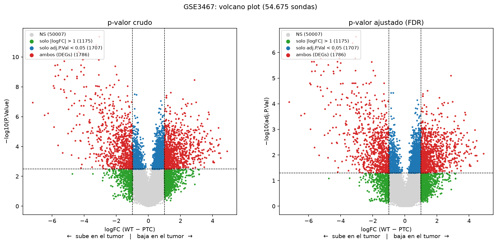
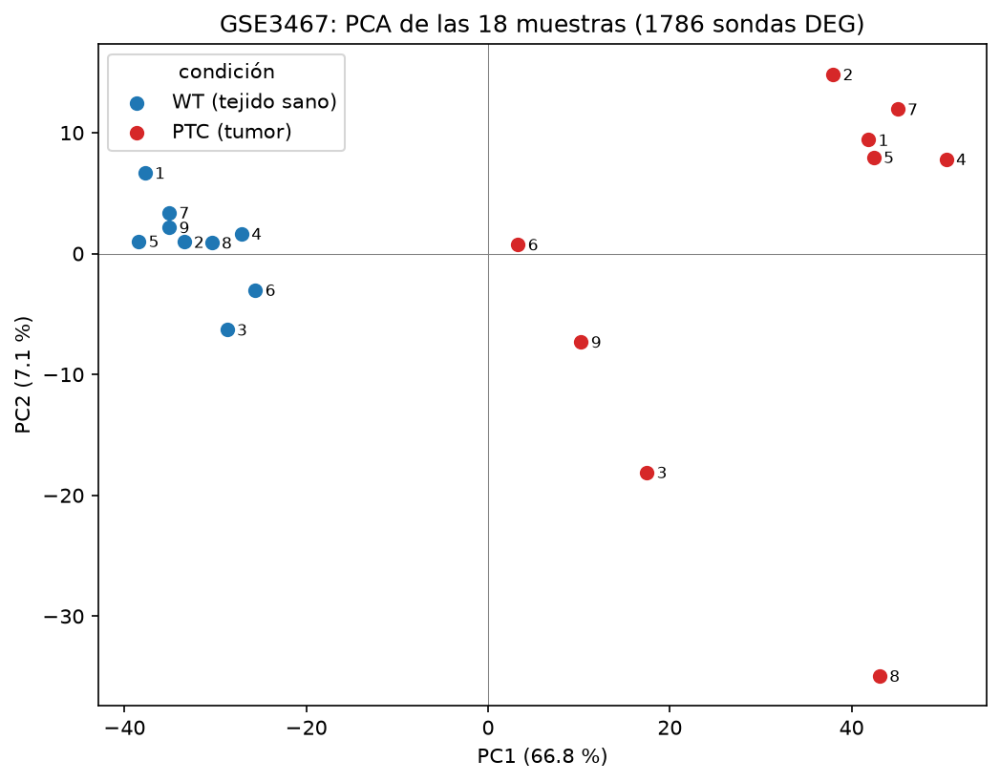
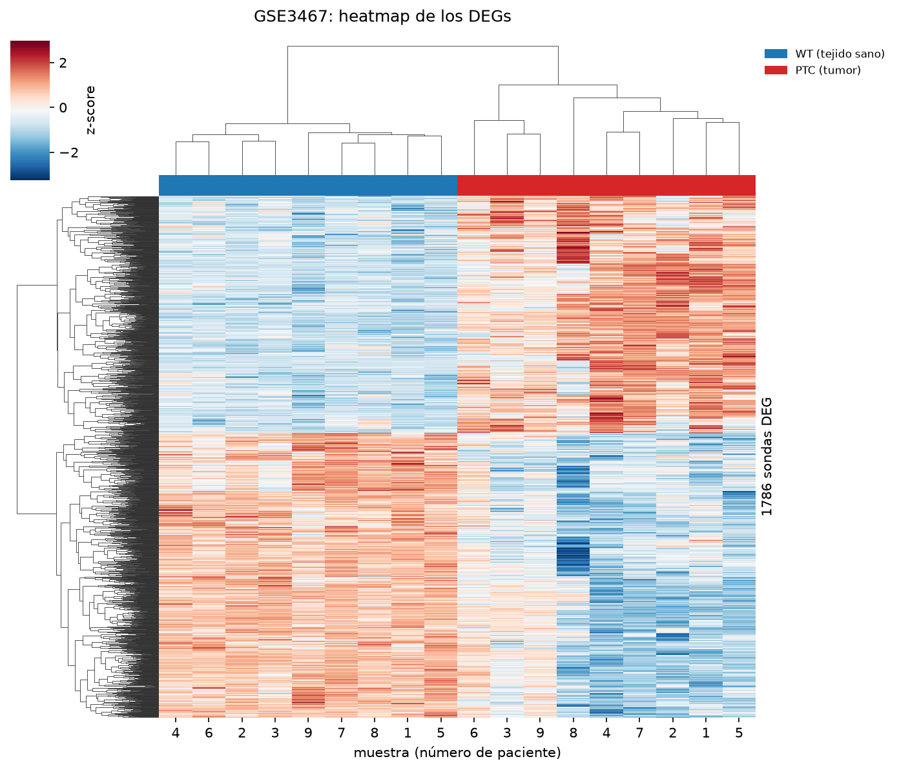

# TP 8: transcriptómica y GSEA

Cada ejercicio se corre por separado desde la raíz del proyecto con el comando `venv/bin/python main.py <ejercicio>`, por ejemplo `venv/bin/python main.py 1.1`; sin argumentos, lista los ejercicios disponibles. Los nombres son `<objetivo>.<ejercicio>`, siguiendo la numeración de la consigna.

El código de cada ejercicio está en `exercises/` (por ejemplo `exercises/obj1/ex1.py`), y la carga de las tablas y el filtrado de DEGs en `degs.py`. Las versiones de las librerías están en `requirements.txt`.

---

## Datos

Usamos el dataset **GSE3467** de GEO: un microarray de Affymetrix que compara 9 carcinomas papilares de tiroides (PTC) con 9 muestras de tiroides sana (WT). Las tablas están en `data/gse3467/`:

- `DE_table.csv`: el resultado de la expresión diferencial para las 54.675 sondas del array. Cada fila es una sonda, identificada por su ID de Affymetrix, con las columnas `logFC`, `AveExpr`, `t`, `P.Value`, `adj.P.Val`, `B` (el log-odds de que la sonda esté diferencialmente expresada, que calcula limma) y los identificadores del gen (`SYMBOL`, `REFSEQ`, `ENTREZID`, `GENENAME`, `ENSEMBL`).
- `full_matrix.csv`: la expresión normalizada de las mismas 54.675 sondas en las 18 muestras, con las columnas intercaladas `WT_001, PTC_001, …, WT_009, PTC_009`.

Las 54.675 sondas corresponden a 21.405 genes distintos, porque un mismo gen puede estar medido por varias sondas. Además, 9.968 sondas no tienen gen asignado (`SYMBOL` vacío).

---

## Objetivo 1. Preparación y gráficos iniciales

### 1

> **1-** Genere un nuevo dataframe a partir de "DE_table" que contenga solo aquellas filas que satisfagan algún criterio de corte a su elección. ¿Cuántos DEGs resultaron de su filtrado?

Antes de elegir un criterio, contamos cuántas sondas pasan cada combinación de cortes por p-valor y por |logFC|. Los cortes de |logFC| son los habituales: 0,58, 1 y 1,5, que equivalen a que la expresión cambie 1,5, 2 y 3 veces entre condiciones; "—" indica que no se aplica corte por logFC. La columna "genes" cuenta símbolos distintos, y las dos últimas separan las sondas según el signo del logFC.

| p-valor | \|logFC\| > | sondas | genes | logFC > 0 | logFC < 0 |
|---|---|---:|---:|---:|---:|
| P.Value < 0,05 | — | 9850 | 6517 | 6089 | 3761 |
| P.Value < 0,05 | 0,58 | 5797 | 3976 | 3596 | 2201 |
| P.Value < 0,05 | 1 | 2712 | 1914 | 1538 | 1174 |
| P.Value < 0,05 | 1,5 | 1247 | 881 | 634 | 613 |
| adj.P.Val < 0,05 | — | 3493 | 2580 | 2159 | 1334 |
| adj.P.Val < 0,05 | 0,58 | 2962 | 2151 | 1760 | 1202 |
| **adj.P.Val < 0,05** | **1** | **1786** | **1277** | **976** | **810** |
| adj.P.Val < 0,05 | 1,5 | 981 | 696 | 489 | 492 |
| adj.P.Val < 0,01 | — | 1380 | 1088 | 785 | 595 |
| adj.P.Val < 0,01 | 0,58 | 1290 | 1005 | 712 | 578 |
| adj.P.Val < 0,01 | 1 | 930 | 699 | 467 | 463 |
| adj.P.Val < 0,01 | 1,5 | 599 | 447 | 271 | 328 |

Elegimos el criterio **adj.P.Val < 0,05 y |logFC| > 1**, con el que quedan **1786 sondas, que corresponden a 1277 genes** (122 de esas sondas no tienen gen asignado). Lo elegimos por tres razones:

- **Usamos el p-valor ajustado y no el crudo.** Se hace un test por cada una de las 54.675 sondas, así que con un corte en p < 0,05 sin ajustar podrían colarse hasta unos 2700 falsos positivos solo por azar (el 5 % de 54.675, si ninguna sonda cambiara de verdad). La tabla lo refleja: con el p-valor crudo pasan 9850 sondas, y con el ajustado por FDR, 3493.
- **El corte por |logFC| > 1 es el que realmente filtra.** Con adj.P.Val < 0,05, exigir además |logFC| > 0,58 casi no cambia el resultado (de 3493 a 2962 sondas): la mayoría de lo que es estadísticamente significativo ya cambia por lo menos 1,5 veces. Con |logFC| > 1 la lista se reduce a la mitad y quedan solo los genes cuya expresión al menos se duplica o se reduce a la mitad, que son los cambios con más chance de tener relevancia biológica.
- **El tamaño de la lista es manejable.** Unos 1300 genes alcanzan para el PCA, el heatmap y el análisis de enriquecimiento sin que estos se llenen de genes con cambios mínimos. Un criterio más estricto, como |logFC| > 1,5 o adj.P.Val < 0,01, dejaría afuera muchos genes con cambios claros y bien sostenidos estadísticamente.

En todas las combinaciones hay más sondas con logFC positivo que negativo. Para interpretarlo hay que saber en qué sentido se calculó el logFC. Para averiguarlo, calculamos para cada sonda la media de expresión de las 9 muestras PTC y la de las 9 WT en `full_matrix.csv`, y comparamos la diferencia con la columna `logFC`. La resta WT − PTC coincide con `logFC` en todas las sondas (la diferencia máxima es del orden de 10⁻¹⁴, un error de redondeo), y la resta PTC − WT da exactamente el valor opuesto. Es decir, **el logFC es WT − PTC: un logFC positivo indica que la sonda se expresa menos en el tumor que en el tejido sano.** Por ejemplo, FN1, LGALS3 y MET, que la literatura describe como aumentados en PTC, tienen logFC negativo.

Entonces, de las 1786 sondas que pasan nuestro criterio, 976 corresponden a genes que bajan en el tumor y 810 a genes que suben: en el PTC son más los genes que se apagan que los que se prenden.

### 2

> **2-** Implemente un volcanoplot para representar todos los puntos de la tabla original "DE_table". Puede añadir una línea horizontal al gráfico si eligió un corte por p-value o dos líneas verticales para el corte de logFC positivo y negativo si eligió logFC para filtrar. Incluso si lo desea puede colorear los puntos de color distinto según el cuadrante en que caigan. ¿Cómo es la dispersión de los puntos? ¿Están más esparcidos por algunos de los dos ejes? ¿Le parece que hizo un filtrado laxo o astringente?

Graficamos las 54.675 sondas con el logFC en el eje X y −log10 del p-valor en el eje Y, y coloreamos cada sonda según los cortes de nuestro criterio que pasa. Como el logFC es WT − PTC (ver ejercicio 1), los genes que suben en el tumor quedan a la izquierda y los que bajan, a la derecha.

| categoría | color | sondas |
|---|---|---:|
| no pasa ningún corte | gris | 50.007 |
| solo \|logFC\| > 1 | verde | 1.175 |
| solo adj.P.Val < 0,05 | azul | 1.707 |
| pasa los dos (DEGs) | rojo | 1.786 |

La figura tiene dos paneles. El de la izquierda es el que pide la consigna, con el p-valor crudo (`P.Value`) en el eje Y. El de la derecha usa el p-valor ajustado (`adj.P.Val`), que es el que usamos para filtrar.

#### El p-valor ajustado (FDR)

Un p-valor < 0,05 significa que, si la sonda en realidad no cambiara, habría un 5 % de chance de observar una diferencia así de grande solo por azar. Para un único test ese riesgo es aceptable, pero acá se hace un test por cada una de las 54.675 sondas: si ninguna cambiara de verdad, igual unas 2700 pasarían el corte solo por azar. Por eso hay que ajustar los p-valores por comparaciones múltiples.

limma los ajusta con el método de **FDR** (*False Discovery Rate*, tasa de descubrimientos falsos) de Benjamini-Hochberg. En lugar de controlar el error de cada test por separado, el FDR controla qué proporción de la lista final son falsos positivos: al quedarnos con las sondas con `adj.P.Val < 0,05`, se espera que como mucho el 5 % de ellas sean falsos positivos. En nuestro caso, de las 3493 sondas con adj.P.Val < 0,05 se esperan como mucho unas 175 falsas. Con el p-valor crudo pasan 9850 sondas, y no hay forma de saber cuántas son ruido: podrían ser hasta unas 2700.

El cálculo es así:

1. Se ordenan las sondas de menor a mayor p-valor crudo.
2. El p-valor de cada sonda se multiplica por el número total de tests dividido por su posición en la lista: la primera se multiplica por 54.675 y la última, por 1.
3. Se corrige el resultado para que ninguna sonda quede con un p ajustado menor que el de una sonda que estaba antes en la lista.

Por el paso 3, varias sondas consecutivas pueden quedar con el mismo p ajustado. Además, el ajuste **no cambia el orden de las sondas**: si una sonda tiene un p crudo menor que otra, su p ajustado también es menor o igual.

#### La línea de corte en cada panel

Como el ajuste respeta el orden, nuestro corte `adj.P.Val < 0,05` equivale a un corte en el p-valor crudo. Al ordenar las sondas por p crudo, la última que pasa tiene `P.Value` = 0,003189 (y `adj.P.Val` = 0,04992), y la primera que queda afuera tiene `P.Value` = 0,003197 (y `adj.P.Val` = 0,05001). Es decir, pedir `adj.P.Val < 0,05` es lo mismo que pedir `P.Value ≤ 0,0032`. Por eso la línea horizontal está en −log10(0,0032) ≈ 2,5 en el panel del p crudo, y en −log10(0,05) ≈ 1,3 en el del p ajustado. Las dos líneas separan exactamente las mismas sondas, y por eso cada sonda tiene el mismo color en los dos paneles: lo único que cambia es la altura a la que se dibuja.

Si filtráramos por el p crudo < 0,05, la línea estaría en 1,3 en el panel izquierdo, bastante más abajo que 2,5, y pasarían muchas más sondas (9850 contra 3493, como vimos en el ejercicio 1).

Comparando los dos paneles se ve el efecto del ajuste: todas las sondas bajan. La más significativa pasa de 11,4 a 6,6 en el eje Y, y la base del volcano se aplasta contra el 0, porque muchas sondas no significativas reciben un p ajustado cercano a 1.

#### Respuestas

**¿Cómo es la dispersión de los puntos?** La enorme mayoría de las sondas forma la base gris del volcano, con logFC cercano a 0 y p-valores altos: la mayor parte de los genes no cambia entre tumor y tejido sano, como es de esperar. El volcano es asimétrico. Del lado derecho (genes que bajan en el tumor) hay más puntos, pero se concentran cerca de los cortes. Del lado izquierdo (genes que suben en el tumor) hay menos, pero alcanzan cambios más grandes (hasta logFC = −7,2, contra 4,9 del lado derecho) y p-valores más chicos: las sondas más significativas son de genes que suben en el tumor.

**¿Están más esparcidos por alguno de los dos ejes?** Por el eje X: el logFC va de −7,2 a 4,9, mientras que −log10(P.Value) no supera 11,4 y se concentra entre 0 y 6. Además, logFC grande no implica significancia: las sondas verdes del lado izquierdo, con logFC < −4 pero por debajo de la línea, tienen cambios grandes en promedio pero muy variables entre muestras, y el corte por p-valor las deja afuera.

**¿Hicimos un filtrado laxo o astringente?** Moderadamente astringente. Hay muchas sondas que pasan uno solo de los dos cortes (1707 en azul y 1175 en verde), así que ninguno de los dos alcanza por sí solo para seleccionar los DEGs. Exigir los dos deja 1786 sondas, alrededor del 3 % del total. El corte más exigente es el del p-valor ajustado, que además ya incluye la corrección por comparaciones múltiples; el corte por |logFC| > 1 agrega el requisito de que el cambio sea de al menos el doble.

### 3

> **3-** Utilice los DEGs que filtró mediante el p-value o el logFC para generar un gráfico de PCA. Para ello necesita el paquete scikit-learn. Además, tendrá que subsetear la matriz "full_matrix.csv" utilizando los DEGs con los que se quedó tras filtrar por logFC/p-value. De modo que el PCA se genere solo con los datos de expresión normalizados de los DEGs. […] Una vez genere el PCA tiene que graficarlo con plt.scatter(). ¿Qué tal es la separación de las muestras? […] ¿Cuánta varianza está explicada solo en el PC1?

#### Qué es un PCA

Cada una de las 18 muestras está descrita por la expresión de los 1786 DEGs (genes diferencialmente expresados), es decir, por 1786 números. Para ver qué muestras se parecen entre sí habría que graficarlas en 1786 ejes, lo que no es posible. El PCA (*Principal Component Analysis*, análisis de componentes principales) resume esos 1786 números en unos pocos puntajes por muestra, que sí se pueden graficar.

La idea se ve con un ejemplo inventado de solo 2 genes, A y B, medidos en 6 muestras. Los números representan cuánto se expresa cada gen en cada muestra, como los de `full_matrix.csv`:

| muestra | gen A | gen B |
|---|---:|---:|
| sano 1 | 2 | 9 |
| sano 2 | 3 | 8 |
| sano 3 | 2 | 8 |
| tumor 1 | 8 | 3 |
| tumor 2 | 9 | 2 |
| tumor 3 | 8 | 2 |

Queremos resumir cada muestra en un solo número combinando A y B. Hay muchas formas de hacerlo; por ejemplo:

| muestra | A + B | solo A | A − B |
|---|---:|---:|---:|
| sano 1 | 11 | 2 | −7 |
| sano 2 | 11 | 3 | −5 |
| sano 3 | 10 | 2 | −6 |
| tumor 1 | 11 | 8 | +5 |
| tumor 2 | 11 | 9 | +7 |
| tumor 3 | 10 | 8 | +6 |

Con A + B todas las muestras dan 10 u 11: ese resumen borra las diferencias entre ellas. Con solo A ya se distinguen (de 2 a 9), y con A − B quedan lo más separadas posible (de −7 a +7). Cuanto más desparramados quedan los números, mejor conserva el resumen las diferencias que había entre las muestras. Qué tan desparramados quedan se mide con la **varianza**.

Eso es lo que hace el PCA: entre todas las formas posibles de combinar los genes (dándole a cada gen un peso, positivo o negativo), busca la que deja los puntajes de las muestras con la mayor varianza. Esa combinación es la **primera componente principal (PC1)**. La **segunda componente principal (PC2)** es la combinación que más desparrama a las muestras entre las que no repiten la información de PC1, y así sucesivamente. La **varianza explicada** por cada componente es la fracción de la varianza total entre las muestras que captura ese puntaje.

El PCA no sabe qué muestras son tumor y cuáles tejido sano: solo busca las combinaciones de genes que más diferencian a las muestras. Si al graficar PC1 contra PC2 los tumores quedan de un lado y los tejidos sanos del otro, eso indica que la mayor diferencia entre las muestras es justamente tumor contra tejido sano.

#### Qué pregunta biológica responde

Las 18 muestras vienen de a pares: según la publicación original del dataset, de cada uno de los 9 pacientes se tomó un pedazo del tumor (PTC, carcinoma papilar de tiroides) y un pedazo de tiroides sana (WT). Por eso las columnas están numeradas de a pares: `WT_001` y `PTC_001` son del paciente 1, y así. No comparamos personas enfermas con personas sanas, sino tejido tumoral con tejido sano dentro de las mismas personas.

Cada muestra tiene un perfil de expresión: cuánto se expresa cada gen en ese pedazo de tejido. En el gráfico del PCA, las muestras con perfiles parecidos quedan cerca y las muestras con perfiles distintos quedan lejos. La pregunta es si el tejido tumoral tiene un perfil propio, que se repite en todos los pacientes y lo distingue del tejido sano. Si los 9 tumores quedan de un lado y los 9 tejidos sanos del otro, el tumor cambia la expresión de los genes de forma consistente, y ser tumor pesa más que ser de un paciente u otro. Si en cambio cada tumor quedara al lado del tejido sano de su mismo paciente, las diferencias entre personas pesarían más que la enfermedad. El gráfico también sirve como control de calidad: una muestra etiquetada como sana que cayera entre los tumores haría sospechar de un error de etiquetado o de una muestra contaminada.

#### Cómo lo hicimos

1. De `full_matrix.csv` nos quedamos con las 1786 sondas de los DEGs (genes diferencialmente expresados) del ejercicio 1, y obtuvimos una matriz de 1786 sondas × 18 muestras.
2. Transpusimos la matriz para que cada fila sea una muestra (18 muestras × 1786 sondas). Así, cada muestra es un punto del PCA, descrito por la expresión de las 1786 sondas.
3. Estandarizamos cada sonda (media 0 y desvío 1) con `StandardScaler`, para que todas pesen parecido y no dominen las sondas con valores de expresión más altos.
4. Calculamos las dos primeras componentes principales con `PCA` de scikit-learn y graficamos cada muestra con PC1 en el eje X y PC2 en el eje Y, coloreada por condición y rotulada con su número de paciente.

**Por qué no usamos el código de la consigna tal cual.** El código de la consigna no transpone la matriz: le pasa al PCA la matriz de 1786 sondas × 18 muestras, así que los puntos del PCA son las sondas, y las muestras aparecen recién al graficar `components_`. Con esa versión, PC1 explica el 72,7 % de la varianza, pero todas las muestras tienen casi el mismo valor de PC1 (entre 0,19 y 0,26): esa componente no separa nada. Lo que captura es que las sondas muy expresadas lo están en todas las muestras, sea cual sea la condición. Con la matriz transpuesta, en cambio, se reproduce casi exactamente la Fig. 2 de la consigna (PC1 66,77 % y PC2 7,13 % en la figura; 66,8 % y 7,1 % en la nuestra, con las mismas muestras intermedias y el mismo PTC_008 alejado). Concluimos que la figura de ejemplo se hizo con las muestras como observaciones, y seguimos ese criterio.

#### Qué significan las componentes en nuestros datos

El PCA le asigna a cada una de las 1786 sondas un peso en cada componente. El valor de PC1 de una muestra es la suma de la expresión (estandarizada) de cada sonda multiplicada por su peso. Estos son los pesos más extremos en PC1:

| gen | peso en PC1 | logFC (WT − PTC) |
|---|---:|---:|
| DPP4 | +0,029 | −5,2 |
| METTL7B | +0,028 | −4,0 |
| BCL2 | −0,028 | +1,9 |
| TMEM171 | −0,028 | +3,3 |

Los genes que suben en el tumor (logFC negativo) reciben peso positivo, y los que bajan en el tumor (logFC positivo) reciben peso negativo. Esto vale para todas las sondas, no solo para estas cuatro: la correlación entre el peso en PC1 y el logFC es −0,92. Además, todos los pesos tienen magnitudes parecidas (entre 0,014 y 0,029), así que ningún gen domina. En la práctica, PC1 funciona como un índice de "tumoralidad": cuánto expresa la muestra los genes que suben en el tumor, menos cuánto expresa los que bajan. Es el equivalente al A − B del ejemplo.

Hay que tener en cuenta que el PCA no sabe que existen dos familias de genes, los que suben y los que bajan. Le asigna a cada sonda su propio peso, y la lectura "genes que suben menos genes que bajan" es nuestra interpretación de los pesos que eligió. Si la mayor diferencia entre las muestras hubiera sido otra, el PCA habría encontrado otra combinación. Por ejemplo:

- **Diferencias entre pacientes:** las muestras se agruparían de a pares, cada tumor junto al tejido sano de su paciente.
- **Sexo:** si hubiera pacientes de ambos sexos, los genes del cromosoma Y podrían formar una componente que separe por sexo.
- **Efecto de lote:** si las muestras se procesaron en tandas distintas, eso puede dejar una huella técnica en la expresión que el PCA detecta.
- **Mezcla de tejidos:** un pedazo de tumor con mucho tejido sano mezclado queda a mitad de camino entre los dos grupos.

Hay además un sesgo a tener en cuenta: usamos solo los DEGs, que elegimos justamente porque difieren entre tumor y tejido sano. Era esperable que separaran los dos grupos. Lo informativo del gráfico no es tanto si se separan, sino cómo: qué tan compacto queda cada grupo y qué muestras quedan en el medio o lejos del resto. Con todas las sondas del array, en PC1 o PC2 podrían aparecer algunas de las otras fuentes de variación de la lista.

#### Resultados

| muestra | PC1 | PC2 | | muestra | PC1 | PC2 |
|---|---:|---:|---|---|---:|---:|
| WT_005 | −38,4 | 1,0 | | PTC_006 | 3,3 | 0,8 |
| WT_001 | −37,8 | 6,7 | | PTC_009 | 10,2 | −7,3 |
| WT_007 | −35,1 | 3,4 | | PTC_003 | 17,5 | −18,1 |
| WT_009 | −35,1 | 2,2 | | PTC_002 | 38,0 | 14,8 |
| WT_002 | −33,5 | 1,0 | | PTC_001 | 41,8 | 9,4 |
| WT_008 | −30,4 | 0,9 | | PTC_005 | 42,4 | 8,0 |
| WT_003 | −28,7 | −6,3 | | PTC_008 | 43,1 | −34,9 |
| WT_004 | −27,1 | 1,7 | | PTC_007 | 45,1 | 12,0 |
| WT_006 | −25,6 | −3,0 | | PTC_004 | 50,4 | 7,8 |

**¿Qué tal es la separación de las muestras?** La separación por condición es completa en PC1: las 9 muestras de tejido sano quedan a la izquierda (PC1 entre −38 y −26) y los 9 tumores a la derecha (PC1 entre 3 y 50), sin ninguna muestra del lado equivocado. Las muestras no se agrupan por paciente, así que la diferencia entre tumor y tejido sano es mayor que la diferencia entre personas, al menos en estos genes.

- **Los tejidos sanos forman un grupo compacto y los tumores están más dispersos.** La tiroides sana se parece mucho entre pacientes, mientras que cada tumor tiene un perfil algo distinto.
- **Tres tumores quedan en una posición intermedia:** PTC_006 (PC1 = 3,3, casi en el centro), PTC_009 y PTC_003. Su perfil está a mitad de camino hacia el tejido sano. Una explicación posible es que esos pedazos de tumor tuvieran tejido sano mezclado; otra, que sean tumores con menos alteraciones.
- **PTC_008 se aparta del resto en PC2.** En PC1 está claramente del lado tumoral (43,1), pero en PC2 llega a −34,9, lejos de todas las demás muestras; PTC_003 tiende hacia el mismo lado, con menor intensidad. PTC_008 tiene alguna característica propia que no comparten los otros tumores. Para saber cuál, habría que ver qué genes tienen más peso en PC2.

**¿Cuánta varianza está explicada solo en el PC1?** El **66,8 %**. Dos tercios de todas las diferencias de expresión entre las 18 muestras, en estos genes, se resumen en un único eje, y ese eje es el que separa tumor de tejido sano. PC2 explica solo el 7,1 %.

### 4

> **4-** Por último el heatmap. Para esto va a necesitar "seaborn" y la matriz de datos de expresión subseteada que ya usó en el PCA.

#### Qué es un heatmap

Un heatmap (mapa de calor) es una tabla en la que los números se reemplazan por colores. Lo explicamos con un ejemplo inventado de 3 genes medidos en 4 muestras, donde cada número es cuánto se expresa el gen en esa muestra:

| | sano 1 | sano 2 | tumor 1 | tumor 2 |
|---|---:|---:|---:|---:|
| gen A | 2 | 3 | 8 | 9 |
| gen B | 9 | 8 | 3 | 2 |
| gen C | 1 | 2 | 7 | 8 |

Si pintamos cada casillero de rojo cuando el valor es alto y de azul cuando es bajo, queda:

| | sano 1 | sano 2 | tumor 1 | tumor 2 |
|---|:-:|:-:|:-:|:-:|
| gen A | azul | azul | rojo | rojo |
| gen B | rojo | rojo | azul | azul |
| gen C | azul | azul | rojo | rojo |

Sin leer los números se ve que los genes A y C se prenden en el tumor y el gen B se apaga.

**Alto o bajo respecto de qué.** Cada gen se compara con su propio promedio en todas las muestras del experimento. El gen A vale 2, 3, 8 y 9, y su promedio es 5,5: en los sanos está por debajo (azul) y en los tumores por encima (rojo). Ese promedio no es un valor "normal" en sentido biológico, es solo el punto de comparación. Comparar cada gen consigo mismo es importante porque los genes tienen niveles de expresión muy distintos. Por ejemplo, este otro gen D está siempre muy prendido:

| | sano 1 | sano 2 | tumor 1 | tumor 2 | promedio |
|---|---:|---:|---:|---:|---:|
| gen A | 2 | 3 | 8 | 9 | 5,5 |
| gen D | 100 | 101 | 108 | 109 | 104,5 |

Si pintáramos según los valores crudos, el gen D quedaría todo rojo y el gen A todo azul, y no veríamos que los dos suben en el tumor. Comparando cada gen con su propio promedio, los dos quedan azules en los sanos y rojos en los tumores. Lo que se muestra es cómo cambia cada gen entre muestras, no si es un gen muy o poco expresado en general.

Además de restarle el promedio, se divide por el desvío estándar del gen (cuánto varía habitualmente), para que la intensidad del color esté en la misma escala para todos los genes. El resultado es el **z-score**:

> z-score = (valor − promedio del gen) / desvío estándar del gen

Un z-score de 0 es el promedio (blanco), un z-score de +2 está bien por encima (rojo intenso) y uno de −2 bien por debajo (azul intenso). Es lo que hace el parámetro `z_score=0` del código de la consigna: estandarizar cada fila por separado. En nuestro caso, el promedio y el desvío de cada sonda se calculan sobre las 18 muestras, tumores y sanos juntos.

Para el z-score se usa la media (el promedio) y no la mediana (el valor del medio al ordenar los datos). La mediana es más robusta frente a valores extremos, y existe una variante del z-score que la usa, pero la definición estándar, que es la que implementa seaborn, usa la media. Además, nuestros datos ya están normalizados y en escala logarítmica, lo que reduce el peso de los valores extremos.

**El clustering.** Por último, el heatmap reordena las filas y las columnas para que queden juntas las que se pintan parecido: pone el gen A al lado del gen C, los sanos juntos y los tumores juntos:

| | sano 1 | sano 2 | tumor 1 | tumor 2 |
|---|:-:|:-:|:-:|:-:|
| gen A | azul | azul | rojo | rojo |
| gen C | azul | azul | rojo | rojo |
| gen B | rojo | rojo | azul | azul |

Así se forman bloques de color. Este reordenamiento es un clustering (agrupamiento) jerárquico. Los árboles (dendrogramas) que aparecen arriba y a la izquierda del gráfico muestran qué filas y qué columnas quedaron agrupadas entre sí: cuanto más abajo se unen dos ramas, más parecidas son. Con `method='complete'`, la distancia entre dos grupos se mide como la distancia entre sus dos miembros más distintos.

#### Cómo lo hicimos

Usamos la misma matriz del PCA, con las 1786 sondas DEG (genes diferencialmente expresados) en las filas y las 18 muestras en las columnas, y la graficamos con `sns.clustermap` con los parámetros de la consigna (`method='complete'`, `cmap='RdBu_r'`, `z_score=0`). A diferencia del PCA, acá no hace falta transponer: el z-score se calcula por sonda (por fila) y el clustering agrupa tanto filas como columnas. Agregamos una barra de color arriba que indica la condición de cada muestra (azul: tejido sano; rojo: tumor), y rotulamos cada columna con su número de paciente. Para describir los grupos, cortamos cada dendrograma en su primera división (la de más arriba), que separa las filas o las columnas en dos grupos.

#### Resultados

**Las muestras se agrupan por condición.** La primera división del dendrograma de muestras separa exactamente los 9 tejidos sanos de los 9 tumores, igual que el PC1 del PCA.

**Las sondas se dividen en dos bloques según hacia dónde cambian.** La primera división del dendrograma de sondas separa:

- **810 sondas que suben en el tumor** (bloque de arriba: azules en los sanos y rojas en los tumores);
- **976 sondas que bajan en el tumor** (bloque de abajo: rojas en los sanos y azules en los tumores).

No hay ninguna sonda mezclada: son exactamente las 810 y 976 sondas con logFC negativo y positivo del ejercicio 1. El clustering no conoce el logFC, así que esto confirma que el patrón de cada sonda es consistente en todas las muestras de cada grupo.

**Los tejidos sanos son homogéneos y los tumores, heterogéneos.** Las columnas de los sanos tienen colores muy parecidos entre sí. Las de los tumores varían más, igual que en el PCA, donde los sanos formaban un grupo compacto y los tumores estaban más dispersos.

**Los tumores 6, 3 y 9 forman una rama aparte.** Dentro de los tumores, el clustering agrupa a PTC_006, PTC_003 y PTC_009 en una rama separada del resto. Son los mismos tres que en el PCA quedaban a mitad de camino hacia el tejido sano. En el heatmap se ve por qué: sus colores son más pálidos, porque sus sondas cambian menos respecto del promedio que en los otros tumores.

**El tumor 8 tiene los colores más intensos.** PTC_008 tiene franjas de rojo y de azul más fuertes que el resto de los tumores, sobre todo un grupo de sondas del bloque de abajo con azul muy intenso. Es probablemente lo mismo que lo separaba de los demás tumores en el PC2 del PCA.
