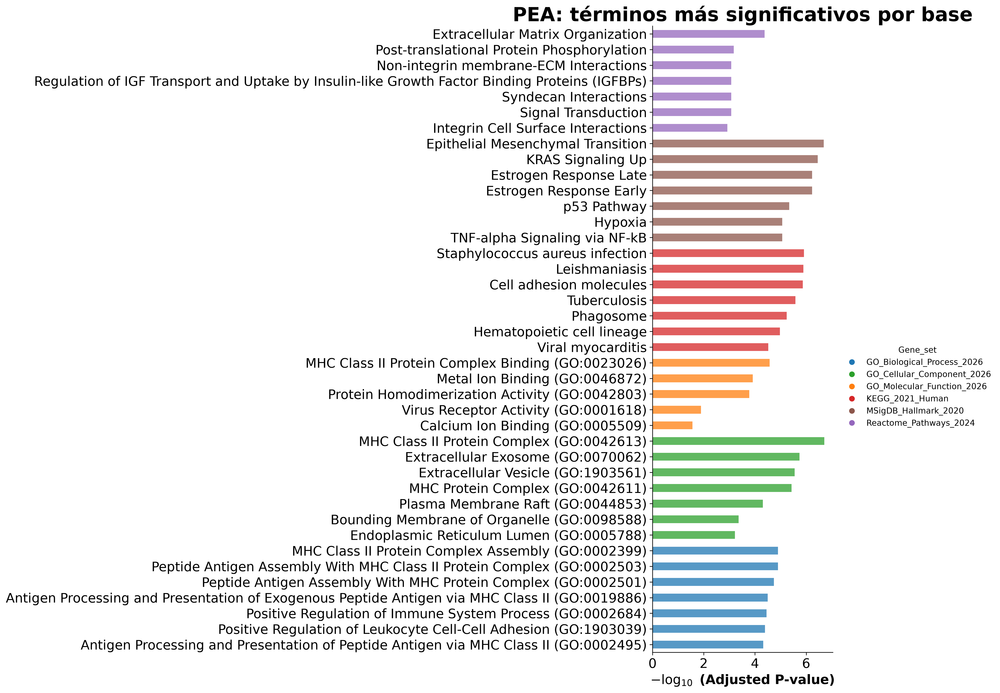
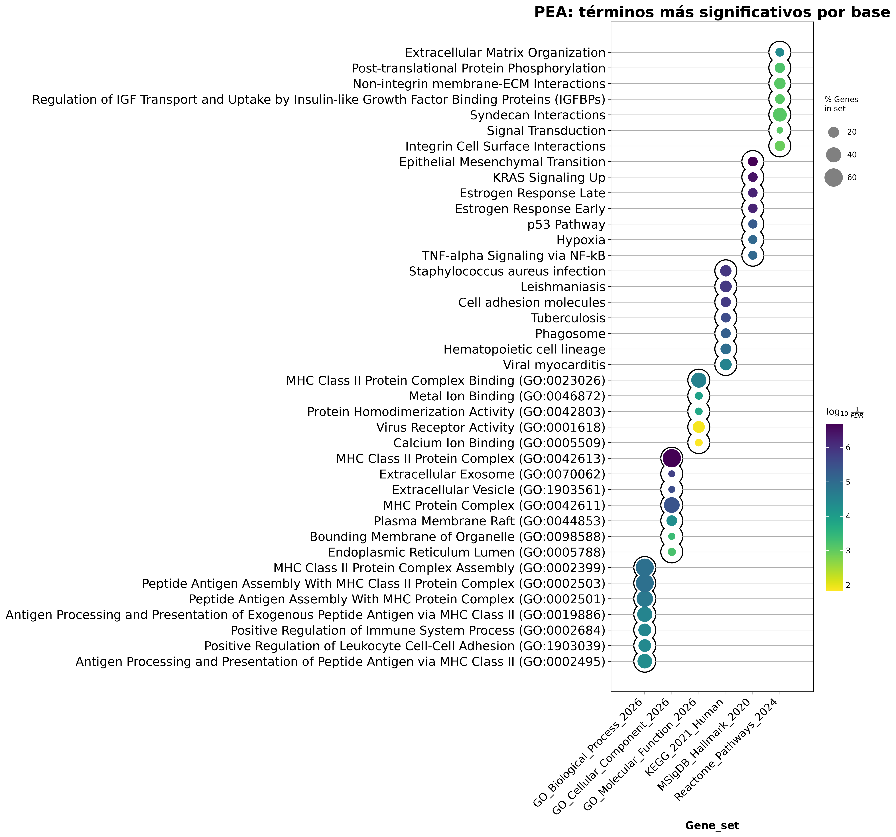
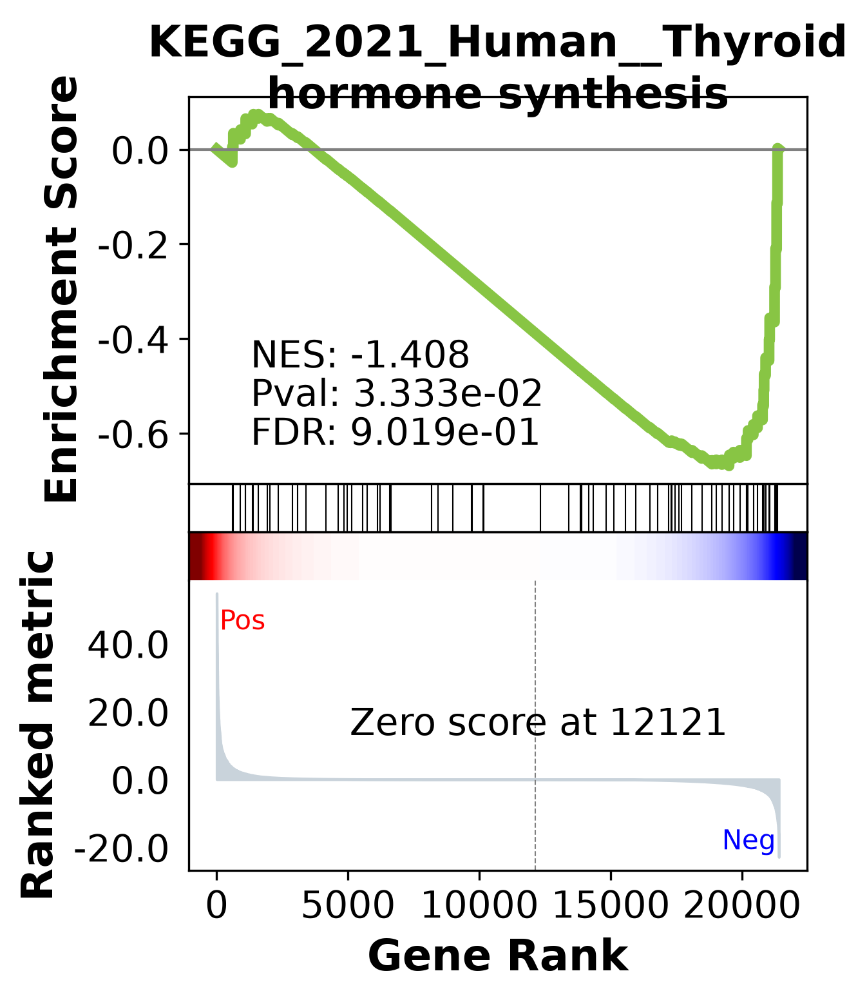
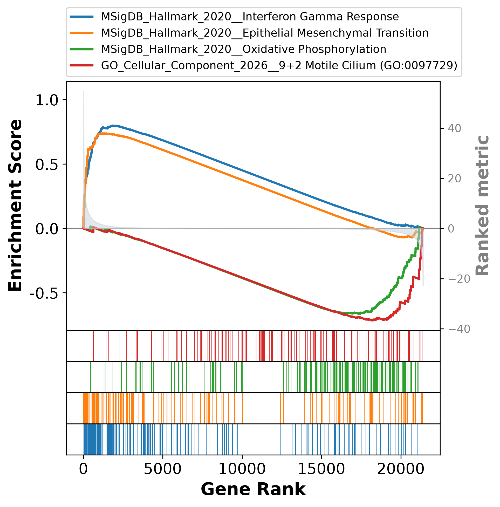

# TP 8: transcriptómica y GSEA

Cada ejercicio se corre por separado desde la raíz del proyecto con el comando `venv/bin/python main.py <ejercicio>`, por ejemplo `venv/bin/python main.py 1.1`; sin argumentos, lista los ejercicios disponibles. Los nombres son `<objetivo>.<ejercicio>`, siguiendo la numeración de la consigna. En el Objetivo 2, la consigna numera por separado los ejercicios de PEA (1 a 3) y los de GSEA (1 a 4), así que los nombres tienen un nivel más: `2.1.<ejercicio>` para PEA (`2.1.1` a `2.1.3`) y `2.2.<ejercicio>` para GSEA (`2.2.1` a `2.2.4`).

El código de cada ejercicio está en `exercises/` (por ejemplo `exercises/obj1/ex1.py`), y la carga de las tablas y el filtrado de DEGs en `degs.py`. Las versiones de las librerías están en `requirements.txt`.

---

## Datos

Usamos el dataset **GSE3467** de GEO: un microarray de Affymetrix que compara 9 carcinomas papilares de tiroides (PTC) con 9 muestras de tiroides sana (WT). Las tablas están en `data/gse3467/`:

- `DE_table.csv`: el resultado de la expresión diferencial para las 54.675 sondas del array. Cada fila es una sonda, identificada por su ID de Affymetrix, con las columnas `logFC`, `AveExpr`, `t`, `P.Value`, `adj.P.Val`, `B` (el log-odds de que la sonda esté diferencialmente expresada, que calcula limma) y los identificadores del gen (`SYMBOL`, `REFSEQ`, `ENTREZID`, `GENENAME`, `ENSEMBL`).
- `full_matrix.csv`: la expresión normalizada de las mismas 54.675 sondas en las 18 muestras, con las columnas intercaladas `WT_001, PTC_001, …, WT_009, PTC_009`.

Las 54.675 sondas corresponden a 21.405 genes distintos, porque un mismo gen puede estar medido por varias sondas. Además, 9.968 sondas no tienen gen asignado (`SYMBOL` vacío).

---

## Objetivo 1. Preparación y gráficos iniciales

### 1

> **1-** Genere un nuevo dataframe a partir de "DE_table" que contenga solo aquellas filas que satisfagan algún criterio de corte a su elección. ¿Cuántos DEGs resultaron de su filtrado?

Antes de elegir un criterio, contamos cuántas sondas pasan cada combinación de cortes por p-valor y por |logFC|. Los cortes de |logFC| son los habituales: 0,58, 1 y 1,5, que equivalen a que la expresión cambie 1,5, 2 y 3 veces entre condiciones; "—" indica que no se aplica corte por logFC. La columna "genes" cuenta símbolos distintos, y las dos últimas separan las sondas según el signo del logFC.

| p-valor | \|logFC\| > | sondas | genes | logFC > 0 | logFC < 0 |
|---|---|---:|---:|---:|---:|
| P.Value < 0,05 | — | 9850 | 6517 | 6089 | 3761 |
| P.Value < 0,05 | 0,58 | 5797 | 3976 | 3596 | 2201 |
| P.Value < 0,05 | 1 | 2712 | 1914 | 1538 | 1174 |
| P.Value < 0,05 | 1,5 | 1247 | 881 | 634 | 613 |
| adj.P.Val < 0,05 | — | 3493 | 2580 | 2159 | 1334 |
| adj.P.Val < 0,05 | 0,58 | 2962 | 2151 | 1760 | 1202 |
| **adj.P.Val < 0,05** | **1** | **1786** | **1277** | **976** | **810** |
| adj.P.Val < 0,05 | 1,5 | 981 | 696 | 489 | 492 |
| adj.P.Val < 0,01 | — | 1380 | 1088 | 785 | 595 |
| adj.P.Val < 0,01 | 0,58 | 1290 | 1005 | 712 | 578 |
| adj.P.Val < 0,01 | 1 | 930 | 699 | 467 | 463 |
| adj.P.Val < 0,01 | 1,5 | 599 | 447 | 271 | 328 |

Elegimos el criterio **adj.P.Val < 0,05 y |logFC| > 1**, con el que quedan **1786 sondas, que corresponden a 1277 genes** (122 de esas sondas no tienen gen asignado). Lo elegimos por tres razones:

- **Usamos el p-valor ajustado y no el crudo.** Se hace un test por cada una de las 54.675 sondas, así que con un corte en p < 0,05 sin ajustar podrían colarse hasta unos 2700 falsos positivos solo por azar (el 5 % de 54.675, si ninguna sonda cambiara de verdad). La tabla lo refleja: con el p-valor crudo pasan 9850 sondas, y con el ajustado por FDR, 3493.
- **El corte por |logFC| > 1 es el que realmente filtra.** Con adj.P.Val < 0,05, exigir además |logFC| > 0,58 casi no cambia el resultado (de 3493 a 2962 sondas): la mayoría de lo que es estadísticamente significativo ya cambia por lo menos 1,5 veces. Con |logFC| > 1 la lista se reduce a la mitad y quedan solo los genes cuya expresión al menos se duplica o se reduce a la mitad, que son los cambios con más chance de tener relevancia biológica.
- **El tamaño de la lista es manejable.** Unos 1300 genes alcanzan para el PCA, el heatmap y el análisis de enriquecimiento sin que estos se llenen de genes con cambios mínimos. Un criterio más estricto, como |logFC| > 1,5 o adj.P.Val < 0,01, dejaría afuera muchos genes con cambios claros y bien sostenidos estadísticamente.

En todas las combinaciones hay más sondas con logFC positivo que negativo. Para interpretarlo hay que saber en qué sentido se calculó el logFC. Para averiguarlo, calculamos para cada sonda la media de expresión de las 9 muestras PTC y la de las 9 WT en `full_matrix.csv`, y comparamos la diferencia con la columna `logFC`. La resta WT − PTC coincide con `logFC` en todas las sondas (la diferencia máxima es del orden de 10⁻¹⁴, un error de redondeo), y la resta PTC − WT da exactamente el valor opuesto. Es decir, **el logFC es WT − PTC: un logFC positivo indica que la sonda se expresa menos en el tumor que en el tejido sano.** Por ejemplo, FN1, LGALS3 y MET, que la literatura describe como aumentados en PTC, tienen logFC negativo.

Entonces, de las 1786 sondas que pasan nuestro criterio, 976 corresponden a genes que bajan en el tumor y 810 a genes que suben: en el PTC son más los genes que se apagan que los que se prenden.

### 2

> **2-** Implemente un volcanoplot para representar todos los puntos de la tabla original "DE_table". Puede añadir una línea horizontal al gráfico si eligió un corte por p-value o dos líneas verticales para el corte de logFC positivo y negativo si eligió logFC para filtrar. Incluso si lo desea puede colorear los puntos de color distinto según el cuadrante en que caigan. ¿Cómo es la dispersión de los puntos? ¿Están más esparcidos por algunos de los dos ejes? ¿Le parece que hizo un filtrado laxo o astringente?


Graficamos las 54.675 sondas con el logFC en el eje X y −log10 del p-valor en el eje Y, y coloreamos cada sonda según los cortes de nuestro criterio que pasa. Como el logFC es WT − PTC (ver ejercicio 1), los genes que suben en el tumor quedan a la izquierda y los que bajan, a la derecha.

| categoría | color | sondas |
|---|---|---:|
| no pasa ningún corte | gris | 50.007 |
| solo \|logFC\| > 1 | verde | 1.175 |
| solo adj.P.Val < 0,05 | azul | 1.707 |
| pasa los dos (DEGs) | rojo | 1.786 |

La figura tiene dos paneles. El de la izquierda es el que pide la consigna, con el p-valor crudo (`P.Value`) en el eje Y. El de la derecha usa el p-valor ajustado (`adj.P.Val`), que es el que usamos para filtrar.

#### El p-valor ajustado (FDR)

Un p-valor < 0,05 significa que, si la sonda en realidad no cambiara, habría un 5 % de chance de observar una diferencia así de grande solo por azar. Para un único test ese riesgo es aceptable, pero acá se hace un test por cada una de las 54.675 sondas: si ninguna cambiara de verdad, igual unas 2700 pasarían el corte solo por azar. Por eso hay que ajustar los p-valores por comparaciones múltiples.

limma los ajusta con el método de **FDR** (*False Discovery Rate*, tasa de descubrimientos falsos) de Benjamini-Hochberg. En lugar de controlar el error de cada test por separado, el FDR controla qué proporción de la lista final son falsos positivos: al quedarnos con las sondas con `adj.P.Val < 0,05`, se espera que como mucho el 5 % de ellas sean falsos positivos. En nuestro caso, de las 3493 sondas con adj.P.Val < 0,05 se esperan como mucho unas 175 falsas. Con el p-valor crudo pasan 9850 sondas, y no hay forma de saber cuántas son ruido: podrían ser hasta unas 2700.

El cálculo es así:

1. Se ordenan las sondas de menor a mayor p-valor crudo.
2. El p-valor de cada sonda se multiplica por el número total de tests dividido por su posición en la lista: la primera se multiplica por 54.675 y la última, por 1.
3. Se corrige el resultado para que ninguna sonda quede con un p ajustado menor que el de una sonda que estaba antes en la lista.

Por el paso 3, varias sondas consecutivas pueden quedar con el mismo p ajustado. Además, el ajuste **no cambia el orden de las sondas**: si una sonda tiene un p crudo menor que otra, su p ajustado también es menor o igual.

#### La línea de corte en cada panel

Como el ajuste respeta el orden, nuestro corte `adj.P.Val < 0,05` equivale a un corte en el p-valor crudo. Al ordenar las sondas por p crudo, la última que pasa tiene `P.Value` = 0,003189 (y `adj.P.Val` = 0,04992), y la primera que queda afuera tiene `P.Value` = 0,003197 (y `adj.P.Val` = 0,05001). Es decir, pedir `adj.P.Val < 0,05` es lo mismo que pedir `P.Value ≤ 0,0032`. Por eso la línea horizontal está en −log10(0,0032) ≈ 2,5 en el panel del p crudo, y en −log10(0,05) ≈ 1,3 en el del p ajustado. Las dos líneas separan exactamente las mismas sondas, y por eso cada sonda tiene el mismo color en los dos paneles: lo único que cambia es la altura a la que se dibuja.

Si filtráramos por el p crudo < 0,05, la línea estaría en 1,3 en el panel izquierdo, bastante más abajo que 2,5, y pasarían muchas más sondas (9850 contra 3493, como vimos en el ejercicio 1).

Comparando los dos paneles se ve el efecto del ajuste: todas las sondas bajan. La más significativa pasa de 11,4 a 6,6 en el eje Y, y la base del volcano se aplasta contra el 0, porque muchas sondas no significativas reciben un p ajustado cercano a 1.

#### Respuestas

**¿Cómo es la dispersión de los puntos?** La enorme mayoría de las sondas forma la base gris del volcano, con logFC cercano a 0 y p-valores altos: la mayor parte de los genes no cambia entre tumor y tejido sano, como es de esperar. El volcano es asimétrico. Del lado derecho (genes que bajan en el tumor) hay más puntos, pero se concentran cerca de los cortes. Del lado izquierdo (genes que suben en el tumor) hay menos, pero alcanzan cambios más grandes (hasta logFC = −7,2, contra 4,9 del lado derecho) y p-valores más chicos: las sondas más significativas son de genes que suben en el tumor.

**¿Están más esparcidos por alguno de los dos ejes?** Por el eje X: el logFC va de −7,2 a 4,9, mientras que −log10(P.Value) no supera 11,4 y se concentra entre 0 y 6. Además, logFC grande no implica significancia: las sondas verdes del lado izquierdo, con logFC < −4 pero por debajo de la línea, tienen cambios grandes en promedio pero muy variables entre muestras, y el corte por p-valor las deja afuera.

**¿Hicimos un filtrado laxo o astringente?** Moderadamente astringente. Hay muchas sondas que pasan uno solo de los dos cortes (1707 en azul y 1175 en verde), así que ninguno de los dos alcanza por sí solo para seleccionar los DEGs. Exigir los dos deja 1786 sondas, alrededor del 3 % del total. El corte más exigente es el del p-valor ajustado, que además ya incluye la corrección por comparaciones múltiples; el corte por |logFC| > 1 agrega el requisito de que el cambio sea de al menos el doble.

### 3

> **3-** Utilice los DEGs que filtró mediante el p-value o el logFC para generar un gráfico de PCA. Para ello necesita el paquete scikit-learn. Además, tendrá que subsetear la matriz "full_matrix.csv" utilizando los DEGs con los que se quedó tras filtrar por logFC/p-value. De modo que el PCA se genere solo con los datos de expresión normalizados de los DEGs. […] Una vez genere el PCA tiene que graficarlo con plt.scatter(). ¿Qué tal es la separación de las muestras? […] ¿Cuánta varianza está explicada solo en el PC1?

#### Qué es un PCA

Cada una de las 18 muestras está descrita por la expresión de los 1786 DEGs (genes diferencialmente expresados), es decir, por 1786 números. Para ver qué muestras se parecen entre sí habría que graficarlas en 1786 ejes, lo que no es posible. El PCA (*Principal Component Analysis*, análisis de componentes principales) resume esos 1786 números en unos pocos puntajes por muestra, que sí se pueden graficar.

La idea se ve con un ejemplo inventado de solo 2 genes, A y B, medidos en 6 muestras. Los números representan cuánto se expresa cada gen en cada muestra, como los de `full_matrix.csv`:

| muestra | gen A | gen B |
|---|---:|---:|
| sano 1 | 2 | 9 |
| sano 2 | 3 | 8 |
| sano 3 | 2 | 8 |
| tumor 1 | 8 | 3 |
| tumor 2 | 9 | 2 |
| tumor 3 | 8 | 2 |

Queremos resumir cada muestra en un solo número combinando A y B. Hay muchas formas de hacerlo; por ejemplo:

| muestra | A + B | solo A | A − B |
|---|---:|---:|---:|
| sano 1 | 11 | 2 | −7 |
| sano 2 | 11 | 3 | −5 |
| sano 3 | 10 | 2 | −6 |
| tumor 1 | 11 | 8 | +5 |
| tumor 2 | 11 | 9 | +7 |
| tumor 3 | 10 | 8 | +6 |

Con A + B todas las muestras dan 10 u 11: ese resumen borra las diferencias entre ellas. Con solo A ya se distinguen (de 2 a 9), y con A − B quedan lo más separadas posible (de −7 a +7). Cuanto más desparramados quedan los números, mejor conserva el resumen las diferencias que había entre las muestras. Qué tan desparramados quedan se mide con la **varianza**.

Eso es lo que hace el PCA: entre todas las formas posibles de combinar los genes (dándole a cada gen un peso, positivo o negativo), busca la que deja los puntajes de las muestras con la mayor varianza. Esa combinación es la **primera componente principal (PC1)**. La **segunda componente principal (PC2)** es la combinación que más desparrama a las muestras entre las que no repiten la información de PC1, y así sucesivamente. La **varianza explicada** por cada componente es la fracción de la varianza total entre las muestras que captura ese puntaje.

El PCA no sabe qué muestras son tumor y cuáles tejido sano: solo busca las combinaciones de genes que más diferencian a las muestras. Si al graficar PC1 contra PC2 los tumores quedan de un lado y los tejidos sanos del otro, eso indica que la mayor diferencia entre las muestras es justamente tumor contra tejido sano.

#### Qué pregunta biológica responde

Las 18 muestras vienen de a pares: según la publicación original del dataset, de cada uno de los 9 pacientes se tomó un pedazo del tumor (PTC, carcinoma papilar de tiroides) y un pedazo de tiroides sana (WT). Por eso las columnas están numeradas de a pares: `WT_001` y `PTC_001` son del paciente 1, y así. No comparamos personas enfermas con personas sanas, sino tejido tumoral con tejido sano dentro de las mismas personas.

Cada muestra tiene un perfil de expresión: cuánto se expresa cada gen en ese pedazo de tejido. En el gráfico del PCA, las muestras con perfiles parecidos quedan cerca y las muestras con perfiles distintos quedan lejos. La pregunta es si el tejido tumoral tiene un perfil propio, que se repite en todos los pacientes y lo distingue del tejido sano. Si los 9 tumores quedan de un lado y los 9 tejidos sanos del otro, el tumor cambia la expresión de los genes de forma consistente, y ser tumor pesa más que ser de un paciente u otro. Si en cambio cada tumor quedara al lado del tejido sano de su mismo paciente, las diferencias entre personas pesarían más que la enfermedad. El gráfico también sirve como control de calidad: una muestra etiquetada como sana que cayera entre los tumores haría sospechar de un error de etiquetado o de una muestra contaminada.

#### Cómo lo hicimos

1. De `full_matrix.csv` nos quedamos con las 1786 sondas de los DEGs (genes diferencialmente expresados) del ejercicio 1, y obtuvimos una matriz de 1786 sondas × 18 muestras.
2. Transpusimos la matriz para que cada fila sea una muestra (18 muestras × 1786 sondas). Así, cada muestra es un punto del PCA, descrito por la expresión de las 1786 sondas.
3. Estandarizamos cada sonda (media 0 y desvío 1) con `StandardScaler`, para que todas pesen parecido y no dominen las sondas con valores de expresión más altos.
4. Calculamos las dos primeras componentes principales con `PCA` de scikit-learn y graficamos cada muestra con PC1 en el eje X y PC2 en el eje Y, coloreada por condición y rotulada con su número de paciente.

**Por qué no usamos el código de la consigna tal cual.** El código de la consigna no transpone la matriz: le pasa al PCA la matriz de 1786 sondas × 18 muestras, así que los puntos del PCA son las sondas, y las muestras aparecen recién al graficar `components_`. Con esa versión, PC1 explica el 72,7 % de la varianza, pero todas las muestras tienen casi el mismo valor de PC1 (entre 0,19 y 0,26): esa componente no separa nada. Lo que captura es que las sondas muy expresadas lo están en todas las muestras, sea cual sea la condición. Con la matriz transpuesta, en cambio, se reproduce casi exactamente la Fig. 2 de la consigna (PC1 66,77 % y PC2 7,13 % en la figura; 66,8 % y 7,1 % en la nuestra, con las mismas muestras intermedias y el mismo PTC_008 alejado). Concluimos que la figura de ejemplo se hizo con las muestras como observaciones, y seguimos ese criterio.

#### Qué significan las componentes en nuestros datos

El PCA le asigna a cada una de las 1786 sondas un peso en cada componente. El valor de PC1 de una muestra es la suma de la expresión (estandarizada) de cada sonda multiplicada por su peso. Estos son los pesos más extremos en PC1:

| gen | peso en PC1 | logFC (WT − PTC) |
|---|---:|---:|
| DPP4 | +0,029 | −5,2 |
| METTL7B | +0,028 | −4,0 |
| BCL2 | −0,028 | +1,9 |
| TMEM171 | −0,028 | +3,3 |

Los genes que suben en el tumor (logFC negativo) reciben peso positivo, y los que bajan en el tumor (logFC positivo) reciben peso negativo. Esto vale para todas las sondas, no solo para estas cuatro: la correlación entre el peso en PC1 y el logFC es −0,92. Además, todos los pesos tienen magnitudes parecidas (entre 0,014 y 0,029), así que ningún gen domina. En la práctica, PC1 funciona como un índice de "tumoralidad": cuánto expresa la muestra los genes que suben en el tumor, menos cuánto expresa los que bajan. Es el equivalente al A − B del ejemplo.

Hay que tener en cuenta que el PCA no sabe que existen dos familias de genes, los que suben y los que bajan. Le asigna a cada sonda su propio peso, y la lectura "genes que suben menos genes que bajan" es nuestra interpretación de los pesos que eligió. Si la mayor diferencia entre las muestras hubiera sido otra, el PCA habría encontrado otra combinación. Por ejemplo:

- **Diferencias entre pacientes:** las muestras se agruparían de a pares, cada tumor junto al tejido sano de su paciente.
- **Sexo:** si hubiera pacientes de ambos sexos, los genes del cromosoma Y podrían formar una componente que separe por sexo.
- **Efecto de lote:** si las muestras se procesaron en tandas distintas, eso puede dejar una huella técnica en la expresión que el PCA detecta.
- **Mezcla de tejidos:** un pedazo de tumor con mucho tejido sano mezclado queda a mitad de camino entre los dos grupos.

Hay además un sesgo a tener en cuenta: usamos solo los DEGs, que elegimos justamente porque difieren entre tumor y tejido sano. Era esperable que separaran los dos grupos. Lo informativo del gráfico no es tanto si se separan, sino cómo: qué tan compacto queda cada grupo y qué muestras quedan en el medio o lejos del resto. Con todas las sondas del array, en PC1 o PC2 podrían aparecer algunas de las otras fuentes de variación de la lista.

#### Resultados


| muestra | PC1 | PC2 | | muestra | PC1 | PC2 |
|---|---:|---:|---|---|---:|---:|
| WT_005 | −38,4 | 1,0 | | PTC_006 | 3,3 | 0,8 |
| WT_001 | −37,8 | 6,7 | | PTC_009 | 10,2 | −7,3 |
| WT_007 | −35,1 | 3,4 | | PTC_003 | 17,5 | −18,1 |
| WT_009 | −35,1 | 2,2 | | PTC_002 | 38,0 | 14,8 |
| WT_002 | −33,5 | 1,0 | | PTC_001 | 41,8 | 9,4 |
| WT_008 | −30,4 | 0,9 | | PTC_005 | 42,4 | 8,0 |
| WT_003 | −28,7 | −6,3 | | PTC_008 | 43,1 | −34,9 |
| WT_004 | −27,1 | 1,7 | | PTC_007 | 45,1 | 12,0 |
| WT_006 | −25,6 | −3,0 | | PTC_004 | 50,4 | 7,8 |

**¿Qué tal es la separación de las muestras?** La separación por condición es completa en PC1: las 9 muestras de tejido sano quedan a la izquierda (PC1 entre −38 y −26) y los 9 tumores a la derecha (PC1 entre 3 y 50), sin ninguna muestra del lado equivocado. Las muestras no se agrupan por paciente, así que la diferencia entre tumor y tejido sano es mayor que la diferencia entre personas, al menos en estos genes.

- **Los tejidos sanos forman un grupo compacto y los tumores están más dispersos.** La tiroides sana se parece mucho entre pacientes, mientras que cada tumor tiene un perfil algo distinto.
- **Tres tumores quedan en una posición intermedia:** PTC_006 (PC1 = 3,3, casi en el centro), PTC_009 y PTC_003. Su perfil está a mitad de camino hacia el tejido sano. Una explicación posible es que esos pedazos de tumor tuvieran tejido sano mezclado; otra, que sean tumores con menos alteraciones.
- **PTC_008 se aparta del resto en PC2.** En PC1 está claramente del lado tumoral (43,1), pero en PC2 llega a −34,9, lejos de todas las demás muestras; PTC_003 tiende hacia el mismo lado, con menor intensidad. PTC_008 tiene alguna característica propia que no comparten los otros tumores. Para saber cuál, habría que ver qué genes tienen más peso en PC2.

**¿Cuánta varianza está explicada solo en el PC1?** El **66,8 %**. Dos tercios de todas las diferencias de expresión entre las 18 muestras, en estos genes, se resumen en un único eje, y ese eje es el que separa tumor de tejido sano. PC2 explica solo el 7,1 %.

### 4

> **4-** Por último el heatmap. Para esto va a necesitar "seaborn" y la matriz de datos de expresión subseteada que ya usó en el PCA.

#### Qué es un heatmap

Un heatmap (mapa de calor) es una tabla en la que los números se reemplazan por colores. Lo explicamos con un ejemplo inventado de 3 genes medidos en 4 muestras, donde cada número es cuánto se expresa el gen en esa muestra:

| | sano 1 | sano 2 | tumor 1 | tumor 2 |
|---|---:|---:|---:|---:|
| gen A | 2 | 3 | 8 | 9 |
| gen B | 9 | 8 | 3 | 2 |
| gen C | 1 | 2 | 7 | 8 |

Si pintamos cada casillero de rojo cuando el valor es alto y de azul cuando es bajo, queda:

| | sano 1 | sano 2 | tumor 1 | tumor 2 |
|---|:-:|:-:|:-:|:-:|
| gen A | azul | azul | rojo | rojo |
| gen B | rojo | rojo | azul | azul |
| gen C | azul | azul | rojo | rojo |

Sin leer los números se ve que los genes A y C se prenden en el tumor y el gen B se apaga.

**Alto o bajo respecto de qué.** Cada gen se compara con su propio promedio en todas las muestras del experimento. El gen A vale 2, 3, 8 y 9, y su promedio es 5,5: en los sanos está por debajo (azul) y en los tumores por encima (rojo). Ese promedio no es un valor "normal" en sentido biológico, es solo el punto de comparación. Comparar cada gen consigo mismo es importante porque los genes tienen niveles de expresión muy distintos. Por ejemplo, este otro gen D está siempre muy prendido:

| | sano 1 | sano 2 | tumor 1 | tumor 2 | promedio |
|---|---:|---:|---:|---:|---:|
| gen A | 2 | 3 | 8 | 9 | 5,5 |
| gen D | 100 | 101 | 108 | 109 | 104,5 |

Si pintáramos según los valores crudos, el gen D quedaría todo rojo y el gen A todo azul, y no veríamos que los dos suben en el tumor. Comparando cada gen con su propio promedio, los dos quedan azules en los sanos y rojos en los tumores. Lo que se muestra es cómo cambia cada gen entre muestras, no si es un gen muy o poco expresado en general.

Además de restarle el promedio, se divide por el desvío estándar del gen (cuánto varía habitualmente), para que la intensidad del color esté en la misma escala para todos los genes. El resultado es el **z-score**:

> z-score = (valor − promedio del gen) / desvío estándar del gen

Un z-score de 0 es el promedio (blanco), un z-score de +2 está bien por encima (rojo intenso) y uno de −2 bien por debajo (azul intenso). Es lo que hace el parámetro `z_score=0` del código de la consigna: estandarizar cada fila por separado. En nuestro caso, el promedio y el desvío de cada sonda se calculan sobre las 18 muestras, tumores y sanos juntos.

Para el z-score se usa la media (el promedio) y no la mediana (el valor del medio al ordenar los datos). La mediana es más robusta frente a valores extremos, y existe una variante del z-score que la usa, pero la definición estándar, que es la que implementa seaborn, usa la media. Además, nuestros datos ya están normalizados y en escala logarítmica, lo que reduce el peso de los valores extremos.

**El clustering.** Por último, el heatmap reordena las filas y las columnas para que queden juntas las que se pintan parecido: pone el gen A al lado del gen C, los sanos juntos y los tumores juntos:

| | sano 1 | sano 2 | tumor 1 | tumor 2 |
|---|:-:|:-:|:-:|:-:|
| gen A | azul | azul | rojo | rojo |
| gen C | azul | azul | rojo | rojo |
| gen B | rojo | rojo | azul | azul |

Así se forman bloques de color. Este reordenamiento es un clustering (agrupamiento) jerárquico. Los árboles (dendrogramas) que aparecen arriba y a la izquierda del gráfico muestran qué filas y qué columnas quedaron agrupadas entre sí: cuanto más abajo se unen dos ramas, más parecidas son. Con `method='complete'`, la distancia entre dos grupos se mide como la distancia entre sus dos miembros más distintos.

#### Cómo lo hicimos

Usamos la misma matriz del PCA, con las 1786 sondas DEG (genes diferencialmente expresados) en las filas y las 18 muestras en las columnas, y la graficamos con `sns.clustermap` con los parámetros de la consigna (`method='complete'`, `cmap='RdBu_r'`, `z_score=0`). A diferencia del PCA, acá no hace falta transponer: el z-score se calcula por sonda (por fila) y el clustering agrupa tanto filas como columnas. Agregamos una barra de color arriba que indica la condición de cada muestra (azul: tejido sano; rojo: tumor), y rotulamos cada columna con su número de paciente. Para describir los grupos, cortamos cada dendrograma en su primera división (la de más arriba), que separa las filas o las columnas en dos grupos.

#### Resultados


**Las muestras se agrupan por condición.** La primera división del dendrograma de muestras separa exactamente los 9 tejidos sanos de los 9 tumores, igual que el PC1 del PCA.

**Las sondas se dividen en dos bloques según hacia dónde cambian.** La primera división del dendrograma de sondas separa:

- **810 sondas que suben en el tumor** (bloque de arriba: azules en los sanos y rojas en los tumores);
- **976 sondas que bajan en el tumor** (bloque de abajo: rojas en los sanos y azules en los tumores).

No hay ninguna sonda mezclada: son exactamente las 810 y 976 sondas con logFC negativo y positivo del ejercicio 1. El clustering no conoce el logFC, así que esto confirma que el patrón de cada sonda es consistente en todas las muestras de cada grupo.

**Los tejidos sanos son homogéneos y los tumores, heterogéneos.** Las columnas de los sanos tienen colores muy parecidos entre sí. Las de los tumores varían más, igual que en el PCA, donde los sanos formaban un grupo compacto y los tumores estaban más dispersos.

**Los tumores 6, 3 y 9 forman una rama aparte.** Dentro de los tumores, el clustering agrupa a PTC_006, PTC_003 y PTC_009 en una rama separada del resto. Son los mismos tres que en el PCA quedaban a mitad de camino hacia el tejido sano. En el heatmap se ve por qué: sus colores son más pálidos, porque sus sondas cambian menos respecto del promedio que en los otros tumores.

**El tumor 8 tiene los colores más intensos.** PTC_008 tiene franjas de rojo y de azul más fuertes que el resto de los tumores, sobre todo un grupo de sondas del bloque de abajo con azul muy intenso. Es probablemente lo mismo que lo separaba de los demás tumores en el PC2 del PCA.

---

## Objetivo 2. Pathway Enrichment Analysis (PEA) y Gene-Set Enrichment Analysis (GSEA)

Hasta acá tenemos una lista de 1277 genes que cambian entre tumor y tejido sano. Una lista de nombres de genes, por sí sola, dice poco. La pregunta del Objetivo 2 es qué **funciones** del tejido están cambiando.

Para responderla se usan bases de datos que agrupan genes según su función: conjuntos (*gene sets*) de genes que participan en un mismo proceso, como la síntesis de hormona tiroidea, la respuesta inmune o la división celular. A cada uno de estos conjuntos se lo llama "vía" o "término".

El **PEA** (*Pathway Enrichment Analysis*, análisis de enriquecimiento de vías) toma la lista de DEGs (genes diferencialmente expresados) y busca qué conjuntos aparecen en ella más de lo que se esperaría por azar. Por ejemplo, si un conjunto de "respuesta inmune" tiene 200 genes y 40 están en nuestra lista, cuando por azar esperaríamos unos 10, decimos que ese conjunto está **enriquecido**: algo pasa con la respuesta inmune en el tumor. El **GSEA** (*Gene Set Enrichment Analysis*, análisis de enriquecimiento de conjuntos de genes) responde la misma pregunta de otra forma, y lo vemos en los ejercicios de GSEA (1 a 4).

### PEA – ejercicio 1

> **1-** Importe "gseapy" y corra la función "get_library_name()". Eche un vistazo a lo que devuelve. Elija algunas bases de datos para usar durante el resto del trabajo práctico. Las más usuales son las mencionadas antes: GO (Molecular Function, Biological Process y Cellular Component), KEGG, Reactome y MSigDB. Recuerde que estamos trabajando con datos humanos.

`get_library_name(organism="Human")` devuelve los nombres de las 228 bases de datos de conjuntos de genes que ofrece Enrichr para humanos. Enrichr es el servicio online que consulta gseapy, así que este ejercicio y los siguientes necesitan conexión a internet. Muchas de esas bases son versiones distintas de la misma colección. Las de las familias que nombra la consigna son:

| base | qué agrupa | versiones disponibles |
|---|---|---|
| **GO** (*Gene Ontology*, ontología de genes) | tres catálogos: *Biological Process* (procesos biológicos, como "división celular"), *Molecular Function* (qué hace la proteína, como "unión de calcio") y *Cellular Component* (en qué parte de la célula está, como "membrana plasmática") | 2021, 2023, 2025, 2026 |
| **KEGG** (*Kyoto Encyclopedia of Genes and Genomes*) | vías metabólicas y de señalización, y genes asociados a enfermedades | 2013, 2015, 2016, 2019_Human, 2021_Human, 2026 |
| **Reactome** | vías y reacciones bioquímicas, con mucho detalle | 2022, 2024 |
| **MSigDB Hallmark** (*Molecular Signatures Database*, colección "Hallmark") | 50 procesos biológicos bien definidos, cada uno resumido en unos 200 genes; muy usada en cáncer | 2020 |

Elegimos las seis bases que nombra la consigna, en su versión más reciente, salvo KEGG:

- `GO_Biological_Process_2026`, `GO_Molecular_Function_2026` y `GO_Cellular_Component_2026`;
- `KEGG_2021_Human`: usamos la versión 2021 y no la 2026 porque el ejercicio 2 de GSEA de la consigna grafica el término `KEGG_2021_Human__Thyroid hormone synthesis`, que tiene que existir con ese nombre;
- `Reactome_Pathways_2024`;
- `MSigDB_Hallmark_2020`.

Usamos las mismas seis bases para el PEA y para el GSEA, para poder comparar los resultados.

### PEA – ejercicio 2

> **2-** Para correr PEA necesita los "gene symbols". Estos los puede obtener de la tabla de expresión diferencial filtrada. Asegúrese de que todos los valores de la columna SYMBOL que extraiga estén en imprenta mayúscula y que no haya "NAs". Además necesitará hacer una lista enumerando aquellas bases de datos que le interesa utilizar para el análisis (las que eligió en el punto anterior). Una vez tenga la lista de bases de datos y la lista de símbolos puede correr el análisis.

De las 1786 sondas que pasan nuestro criterio, sacamos la columna `SYMBOL`, descartamos las 122 sondas sin gen asignado (los "NAs"), pasamos los símbolos a mayúscula y eliminamos los repetidos, porque un mismo gen puede estar medido por varias sondas. Quedan **1277 símbolos de gen únicos**, que le pasamos a `gp.enrichr` junto con las seis bases elegidas.

#### Cómo se calcula el enriquecimiento

Para cada término de cada base, Enrichr cuenta cuántos de nuestros genes pertenecen a él y compara ese número con lo que se esperaría si hubiéramos elegido 1277 genes al azar, mediante un test exacto de Fisher. Como se evalúan miles de términos, el p-valor se ajusta por comparaciones múltiples con el mismo método de FDR (*False Discovery Rate*, tasa de descubrimientos falsos) que usamos para los DEGs (ver Objetivo 1, ejercicio 2).

La tabla de resultados (`res.results`) tiene una fila por término. Las columnas más importantes son:

- **Gene_set:** la base de datos de la que viene el término.
- **Term:** el nombre del término.
- **Overlap:** cuántos de nuestros genes están en el término, sobre el total de genes del término. Por ejemplo, `10/16` significa que el término tiene 16 genes y 10 están en nuestra lista.
- **Adjusted P-value:** el p-valor ajustado. Si es menor que 0,05, consideramos que el término está enriquecido en nuestra lista y que no es una coincidencia atribuible al azar.
- **Genes:** cuáles de nuestros genes coincidieron con el término.

#### Resultados

Se evaluaron 7149 términos, de los cuales **242 tienen Adjusted P-value < 0,05**:

| base | términos significativos |
|---|---:|
| GO Biological Process | 79 |
| GO Molecular Function | 5 |
| GO Cellular Component | 52 |
| KEGG | 36 |
| Reactome | 47 |
| MSigDB Hallmark | 23 |

Los términos más significativos de cada base son:

- **GO Biological Process:** ensamblado del complejo MHC de clase II (MHC: complejo mayor de histocompatibilidad, las proteínas que les presentan antígenos a los linfocitos), procesamiento y presentación de antígenos vía MHC de clase II, regulación positiva del sistema inmune, adhesión entre leucocitos y regulación de la migración celular.
- **GO Molecular Function:** unión al complejo MHC de clase II, unión de iones metálicos y de calcio, y actividad de receptor de virus.
- **GO Cellular Component:** complejo MHC de clase II, exosomas y vesículas extracelulares, *rafts* (microdominios) de la membrana plasmática y lumen del retículo endoplásmico.
- **KEGG:** infecciones (*Staphylococcus aureus*, leishmaniasis, tuberculosis, toxoplasmosis, miocarditis viral), moléculas de adhesión celular, fagosoma y linaje de células hematopoyéticas.
- **Reactome:** organización de la matriz extracelular, interacciones entre la membrana y la matriz extracelular (sindecanos, integrinas), transporte de IGF (factor de crecimiento similar a la insulina) y señalización por interferón gamma.
- **MSigDB Hallmark:** transición epitelio-mesénquima, señalización por KRAS (un oncogén), respuesta a estrógenos, vía de p53 (un supresor tumoral), señalización de TNF-alfa (factor de necrosis tumoral) vía NF-κB, hipoxia y complemento.

Las tendencias que muestran estos términos las analizamos en el ejercicio 3 de PEA, con los gráficos.

#### Limitaciones

- **El PEA no distingue genes que suben de genes que bajan.** Le pasamos los 1277 DEGs juntos, así que un término enriquecido puede deberse a genes que se prenden en el tumor, a genes que se apagan o a una mezcla. Para saberlo hay que mirar la columna `Genes` y el logFC de cada uno, o usar el GSEA.
- **Depende del criterio de corte de los DEGs.** Con otro criterio (por ejemplo, |logFC| > 0,58) la lista sería distinta y los términos enriquecidos podrían cambiar.
- **El universo de comparación.** Por defecto, Enrichr compara nuestra lista con todos los genes de cada base de datos, no con los 21.405 genes medidos en el array, que serían el universo más apropiado. Esto puede inflar un poco la significancia de algunos términos.

### PEA – ejercicio 3

> **3-** Mucho más práctico es visualizar el resultado del análisis gráficamente. Para esto, gseapy nos provee un par de funciones de graficado. ¿Nota alguna tendencia en los tipos de vías que resultaron significativas?

Graficamos los términos con Adjusted P-value < 0,05 usando `gp.dotplot` y `gp.barplot`, con los 7 términos más significativos de cada base (`top_term=7`), como en la consigna. En el barplot coloreamos las barras según la base de datos, para distinguir de dónde viene cada término.

#### Cómo leer los gráficos



**Barplot:** una barra por término. El largo de la barra es −log10 del p-valor ajustado, así que **cuanto más larga la barra, más significativo es el término**, es decir, menos probable que el enriquecimiento sea casualidad. Por ejemplo, una barra de largo 6 corresponde a un p-valor ajustado de 10⁻⁶.



**Dotplot:** los mismos términos, uno por fila, ubicados en la columna de la base a la que pertenecen. Muestra dos datos por término:

- **el color** es la significancia (log10 de 1/FDR): cuanto más oscuro, más significativo;
- **el tamaño del punto** es el porcentaje de los genes del término que están en nuestra lista. Por ejemplo, el término "MHC Class II Protein Complex" tiene un punto grande porque 11 de sus 17 genes están entre nuestros DEGs (genes diferencialmente expresados).

#### Tendencias

Los términos significativos se agrupan en tres grandes temas, que aparecen de forma consistente en bases de datos distintas:

1. **Sistema inmune.** Es el tema dominante. En GO (*Gene Ontology*) aparecen el complejo MHC de clase II (complejo mayor de histocompatibilidad, las proteínas que presentan antígenos a los linfocitos) y el procesamiento y la presentación de antígenos. En KEGG aparecen vías de infecciones (*Staphylococcus aureus*, tuberculosis, leishmaniasis, toxoplasmosis), el fagosoma y el linaje de células hematopoyéticas. En MSigDB Hallmark, la señalización de TNF-alfa (factor de necrosis tumoral) vía NF-κB y el complemento. Las vías de infecciones no indican que haya una infección: aparecen porque comparten muchos genes de la respuesta inmune, como los del MHC. Esto es coherente con lo que se sabe del carcinoma papilar de tiroides, que suele estar infiltrado por linfocitos y otras células inmunes, y cuyas células tumorales pueden empezar a expresar MHC de clase II.
2. **Matriz extracelular, adhesión e invasión.** Reactome muestra la organización de la matriz extracelular y las interacciones de la membrana celular con ella (integrinas, sindecanos), y KEGG, las moléculas de adhesión celular. En MSigDB Hallmark, el término más significativo es la transición epitelio-mesénquima, el proceso por el cual una célula epitelial pierde su adhesión a las vecinas y gana capacidad de moverse. Son procesos típicos de un tumor que remodela el tejido que lo rodea y lo invade.
3. **Vías típicas de cáncer.** En MSigDB Hallmark aparecen la señalización por KRAS (en el carcinoma papilar de tiroides es frecuente que esta misma cascada de señalización esté activada por mutaciones en BRAF o RAS), la vía de p53 (un supresor tumoral), la hipoxia y la respuesta a estrógenos.

Los términos de GO Molecular Function y GO Cellular Component son en general más inespecíficos ("unión de iones metálicos", "exosoma extracelular"). Los más informativos vuelven a ser los del complejo MHC de clase II.

#### Dirección de los cambios

Como el PEA no distingue entre genes que suben y genes que bajan (ver PEA – ejercicio 2), contamos, para cada uno de los términos graficados, cuántos de sus genes suben y cuántos bajan en el tumor. Usamos el signo del logFC, recordando que es WT − PTC: negativo significa que el gen sube en el tumor. Cuando un gen tiene varias sondas entre los DEGs, usamos la de mayor |logFC|. Algunos ejemplos:

| término | base | suben en el tumor | bajan en el tumor |
|---|---|---:|---:|
| MHC Class II Protein Complex | GO Cellular Component | 11 | 0 |
| Antigen Processing and Presentation via MHC Class II | GO Biological Process | 12 | 0 |
| *Staphylococcus aureus* infection | KEGG | 24 | 0 |
| Tuberculosis | KEGG | 28 | 5 |
| p53 Pathway | MSigDB Hallmark | 31 | 2 |
| TNF-alpha Signaling via NF-kB | MSigDB Hallmark | 28 | 4 |
| Epithelial Mesenchymal Transition | MSigDB Hallmark | 31 | 6 |
| Extracellular Matrix Organization | Reactome | 38 | 8 |
| Hypoxia | MSigDB Hallmark | 16 | 16 |
| Metal Ion Binding | GO Molecular Function | 33 | 33 |

**Casi todos los términos principales se explican por genes que suben en el tumor**, aunque entre nuestros 1277 DEGs hay más genes que bajan (675) que genes que suben (602). Los términos inmunes son los más extremos: en varios, todos los genes de nuestra lista suben en el tumor. Los únicos términos con genes repartidos de forma pareja son los más generales, como la hipoxia o la unión de iones metálicos.

Esto sugiere que los genes que se prenden en el tumor se concentran en unos pocos procesos bien definidos (respuesta inmune, remodelado de la matriz, invasión), mientras que los genes que se apagan están más repartidos entre procesos distintos y ninguno alcanza a destacarse en el PEA. Llama la atención que no aparezca entre los términos principales la pérdida de la función tiroidea (la síntesis de hormona tiroidea), que es esperable en un tumor de tiroides. El GSEA, que tiene en cuenta la dirección de los cambios y usa todos los genes, debería mostrarla mejor: lo vemos en los ejercicios de GSEA.

### Gene-Set Enrichment Analysis (GSEA)

#### Por qué otro análisis

El PEA (análisis de enriquecimiento de vías) tiene dos limitaciones, que vimos en los ejercicios 2 y 3 de PEA:

1. **No distingue genes que suben de genes que bajan.** Recibe una lista de genes sin dirección. Para saber hacia dónde cambiaba cada término tuvimos que contar a mano.
2. **Depende del criterio de corte de los DEGs (genes diferencialmente expresados).** Un gen con |logFC| = 0,99 queda afuera y uno con 1,01 queda adentro, aunque sean casi iguales, y con otro criterio el resultado cambiaría.

El **GSEA** (*Gene Set Enrichment Analysis*, análisis de enriquecimiento de conjuntos de genes) resuelve las dos cosas: en lugar de una lista cortada, usa **todos los genes, ordenados** según cuánto y en qué dirección cambian.

#### La idea

Primero se ordenan todos los genes en una fila, desde el que más sube en una condición hasta el que más baja, con los que no cambian en el medio. Después, para cada conjunto de genes (cada término de las bases de datos), se marca dónde caen sus integrantes en esa fila:

```
principio de la fila  ←—————————————  no cambian  —————————————→  final de la fila
   G1  G2  G3  G4  G5  G6  G7  G8  G9  G10  ...  G20000
   |   |       |                                   |
```

Si los genes del conjunto se amontonan en una de las puntas, el conjunto entero se movió en esa dirección. Si están desparramados al azar por toda la fila, ese proceso no cambió. El GSEA mide justamente eso: si los genes de cada conjunto están amontonados en una punta de la fila o desparramados.

#### Cómo se mide

**El puntaje de enriquecimiento (ES, *Enrichment Score*).** Se recorre la fila de principio a fin con un contador que empieza en 0. Cada vez que aparece un gen del conjunto, el contador sube; cada vez que aparece un gen que no es del conjunto, baja un poco. Si los genes del conjunto están al principio de la fila, el contador sube rápido y forma un pico alto. Si están al final, el contador primero baja mucho (pasa por muchos genes que no son del conjunto) y forma un valle profundo antes de subir. El puntaje de enriquecimiento es la altura del pico o la profundidad del valle, la que esté más lejos de 0:

- cerca de +1: los genes del conjunto están amontonados al principio de la fila;
- cerca de −1: están amontonados al final;
- cerca de 0: están desparramados.

Ese recorrido del contador es la curva que se ve en los gráficos de GSEA (Fig. 6 de la consigna).

**El puntaje de enriquecimiento normalizado (NES, *Normalized Enrichment Score*).** El tamaño del conjunto influye en el puntaje. Con un conjunto de 10 genes es bastante fácil que, por casualidad, varios caigan cerca del principio de la fila y el puntaje llegue a 0,5. Con un conjunto de 300 genes, en cambio, un puntaje de 0,5 por azar es muy improbable. El mismo valor no vale lo mismo en un conjunto chico que en uno grande. Para corregirlo, el programa mezcla la fila al azar muchas veces (1000 en nuestro caso, el parámetro `permutation_num`), calcula qué puntaje obtiene cada conjunto por pura casualidad, y divide el puntaje real por el que se obtiene típicamente por azar. Por ejemplo:

| conjunto | genes | puntaje real | puntaje típico por azar | puntaje normalizado |
|---|---:|---:|---:|---:|
| A | 10 | 0,5 | 0,4 | 0,5 / 0,4 ≈ 1,25 |
| B | 300 | 0,5 | 0,15 | 0,5 / 0,15 ≈ 3,3 |

El puntaje normalizado indica cuántas veces más amontonado está el conjunto de lo que estaría por azar, y conserva el signo: positivo si está amontonado al principio de la fila y negativo si está al final. Cuanto más lejos de 0, más fuerte es el efecto. Es el que se usa para comparar términos entre sí.

**El FDR q-val.** Es la probabilidad de que el amontonamiento observado sea casualidad, calculada a partir de las mismas permutaciones y ajustada por comparaciones múltiples con el FDR (*False Discovery Rate*, tasa de descubrimientos falsos), porque se evalúan miles de conjuntos. Consideramos significativos los términos con FDR q-val < 0,05.

**Los genes líderes (`Lead_genes`).** Son los genes del conjunto que están en la punta donde se amontonan, antes del pico (o del valle) del contador: son los que más contribuyen al resultado.

#### El ranking y su signo

La consigna ordena los genes según el puntaje

> rank = −log10(P.Value) × logFC

- −log10(P.Value) es grande cuando el cambio es estadísticamente muy confiable.
- logFC es grande cuando el cambio es grande, y su signo indica la dirección.

Multiplicados, quedan al principio de la fila los genes con logFC positivo grande y p-valor chico, y al final los de logFC negativo grande y p-valor chico. Los genes que no cambian, o cuyo cambio es dudoso, quedan en el medio.

En nuestros datos, el logFC es WT − PTC (ver Objetivo 1, ejercicio 1). Con la fórmula tal cual, al principio de la fila quedarían los genes más expresados en el tejido sano, y un puntaje normalizado positivo significaría "más activo en el tejido sano". Para que la lectura sea más intuitiva, **invertimos el signo del logFC**, es decir, usamos PTC − WT:

> rank = −log10(P.Value) × (−logFC)

Así, al principio de la fila quedan los genes que suben en el tumor, y **un puntaje normalizado positivo significa que el conjunto está más activo en el tumor; uno negativo, que está más activo en el tejido sano**. Una consecuencia: la Fig. 6 de la consigna muestra "Thyroid hormone synthesis" con puntaje normalizado positivo, lo que es consistente con que la cátedra usó el logFC tal como viene (WT − PTC), ya que la síntesis de hormona tiroidea es más activa en el tejido sano. Con nuestra convención, ese término debería dar negativo.

### GSEA – ejercicio 1

> **4-** Anexe a la DE_table original una columna con el puntaje de ranking correspondiente. Este se calcula como -log10(pVal)*logFC. Luego reordene la tabla en el sentido descendiente de la columna de ranking. Genere un nuevo dataframe que contenga solo las columnas "SYMBOL" y "rank". Asegúrese de que todos los símbolos estén en imprenta mayúscula y elimine cualquier fila que contenga NA. Este dataframe nuevo es lo que daremos de comer a la función que realiza el GSEA junto con una lista de bases de datos que queremos que utilice.

#### Cómo armamos el ranking

1. A cada sonda de `DE_table` le calculamos el puntaje `rank = −log10(P.Value) × (−logFC)`, con el signo del logFC invertido para que un puntaje positivo signifique "sube en el tumor" (ver la sección anterior).
2. Descartamos las sondas sin gen asignado y pasamos los símbolos a mayúscula.
3. **Nos quedamos con una sonda por gen.** El ranking necesita un único puntaje por gen, pero 11.461 genes tienen más de una sonda (por ejemplo, FN1, la fibronectina, tiene 7). Elegimos, para cada gen, **la sonda con mayor expresión media** (columna `AveExpr`).
4. Ordenamos de mayor a menor puntaje y nos quedamos con las columnas `SYMBOL` y `rank`.

**Por qué la sonda de mayor expresión media.** Las distintas sondas de un gen no son mediciones repetidas de un mismo valor. Muchas veces una sonda mide bien el gen y otras casi no detectan señal, porque apuntan a una variante del ARN que no está presente o porque hibridan mal. Por eso descartamos dos alternativas:

- **Promediar los puntajes de las sondas** diluye la señal de la sonda buena con la de las sondas que no detectan nada.
- **Quedarse con la sonda más cercana al promedio** tiene el mismo problema, porque el promedio queda arrastrado por las sondas malas. Además, cuando hay dos sondas (el caso más frecuente, 5462 genes), las dos quedan a la misma distancia del promedio y no se puede elegir.

Por ejemplo, para LGALS3 y MET:

| gen | sonda | logFC | expresión media | puntaje |
|---|---|---:|---:|---:|
| LGALS3 | 208949_s_at | −2,23 | 12,0 | 17,78 |
| LGALS3 | 1557197_a_at | 0,00 | 2,2 | 0,00 |
| MET | 203510_at | −2,31 | 11,5 | 12,99 |
| MET | 213807_x_at | −1,79 | 5,2 | 3,45 |
| MET | 211599_x_at | −1,82 | 6,5 | 2,77 |
| MET | 213816_s_at | −0,73 | 2,6 | 0,88 |

En LGALS3, el promedio (8,89) queda a la misma distancia de las dos sondas. En MET, el promedio (5,02) está más cerca de la sonda de 3,45, que casi no detecta señal, que de la de 12,99, que es la que realmente mide el gen. Elegir por expresión media se queda en los dos casos con la sonda que mide bien. Además, a diferencia de elegir la sonda de puntaje más extremo, este criterio **no mira el resultado**: no favorece a las sondas que, por azar, muestran un cambio más grande.

El ranking final tiene **21.405 genes**: 12.121 con puntaje positivo y 9262 con puntaje negativo. Al principio de la fila (los que más suben en el tumor) están HMGA2 (54,8), LRP4 y TENM1; al final (los que más suben en el tejido sano), LRP1B (−22,9), RYR2 y SPX. gseapy avisa que hay valores repetidos en el ranking: son unos 2100 genes con puntaje exactamente 0, que quedan en el medio de la fila. Su orden entre ellos es arbitrario, pero no afecta el resultado, porque el enriquecimiento depende de lo que pasa en las puntas.

Corrimos `gp.prerank` con las seis bases elegidas y 1000 permutaciones, con una semilla fija (`seed=42`) para que las permutaciones, que son al azar, den siempre el mismo resultado. Como el análisis tarda alrededor de un minuto, el resultado se guarda en `results/gsea_prerank.pkl` y los ejercicios siguientes lo leen de ahí.

#### Resultados

Se evaluaron 5277 términos, de los cuales **69 tienen FDR q-val < 0,05**: **65 con puntaje normalizado (NES) positivo**, es decir, más activos en el tumor, y **solo 4 con puntaje normalizado negativo**, más activos en el tejido sano.

Los 10 términos con mayor puntaje normalizado, más activos en el tumor:

| término | base | puntaje normalizado | FDR q-val |
|---|---|---:|---:|
| Allograft Rejection (rechazo de trasplante) | MSigDB Hallmark | 1,89 | < 0,001 |
| Serine-type Endopeptidase Activity (actividad de serina-proteasa) | GO Molecular Function | 1,84 | < 0,001 |
| Coagulation (coagulación) | MSigDB Hallmark | 1,82 | < 0,001 |
| Secretory Granule Lumen (interior de gránulos de secreción) | GO Cellular Component | 1,81 | < 0,001 |
| Serine-type Peptidase Activity (actividad de serina-peptidasa) | GO Molecular Function | 1,81 | < 0,001 |
| Neutrophil Degranulation (degranulación de neutrófilos) | Reactome | 1,80 | < 0,001 |
| Extracellular Matrix Organization (organización de la matriz extracelular) | Reactome | 1,78 | < 0,001 |
| Interferon Gamma Response (respuesta a interferón gamma) | MSigDB Hallmark | 1,77 | < 0,001 |
| Immunoregulatory Interactions Between a Lymphoid and a non-Lymphoid Cell (interacciones inmunorreguladoras entre linfocitos y otras células) | Reactome | 1,77 | < 0,001 |
| *Staphylococcus aureus* infection | KEGG | 1,77 | < 0,001 |

Los 4 términos más activos en el tejido sano:

| término | base | puntaje normalizado | FDR q-val |
|---|---|---:|---:|
| Sensory Perception of Smell (percepción del olfato) | GO Biological Process | −1,73 | 0,004 |
| Postsynaptic Density Membrane (membrana postsináptica) | GO Cellular Component | −1,70 | < 0,001 |
| 9+2 Motile Cilium (cilio móvil) | GO Cellular Component | −1,60 | 0,019 |
| Oxidative Phosphorylation (fosforilación oxidativa) | MSigDB Hallmark | −1,59 | 0,003 |

Del lado del tumor aparecen los mismos temas que en el PEA (análisis de enriquecimiento de vías): respuesta inmune, matriz extracelular y vías de cáncer, como la señalización por KRAS o la angiogénesis (formación de vasos sanguíneos). Además aparecen la coagulación y las proteasas (enzimas que cortan proteínas). Del lado del tejido sano, en cambio, hay muy pocos términos. La fosforilación oxidativa (la respiración en las mitocondrias) es biológicamente plausible. La percepción del olfato y la membrana postsináptica no tienen relación esperable con la tiroides, y probablemente reflejen genes que casi no se expresan en este tejido. Esto confirma lo que observamos en el PEA: los genes que se prenden en el tumor se concentran en procesos bien definidos, mientras que los que se apagan están repartidos entre procesos distintos.

#### La síntesis de hormona tiroidea

El término "Thyroid hormone synthesis" de KEGG (*Kyoto Encyclopedia of Genes and Genomes*), que la consigna usa de ejemplo en el ejercicio 2 de GSEA, tiene puntaje normalizado **−1,41**, en la dirección esperada (más activo en el tejido sano), pero **FDR q-val = 0,90**: no es significativo. En la Fig. 6 de la consigna, en cambio, sí lo es (FDR 0,011).

Los genes específicos de la función tiroidea sí están al final de la fila, del lado del tejido sano: TPO (tiroperoxidasa), DIO1 y DIO2 (desyodasas), SLC26A4 (pendrina), IYD, TSHR (receptor de la hormona estimulante de la tiroides) y PAX8 están todos entre los últimos ~500 de los 21.405 genes. Pero el término tiene 75 genes, y muchos son genes de uso general (bombas de iones, proteínas de la vía de secreción) que participan en esta vía y en muchas otras, casi no cambian y están repartidos por toda la fila: diluyen la señal de los genes específicos. Además, la tiroglobulina (TG), el gen más característico de la tiroides, queda en la posición 18.469, casi en el medio. Su única sonda tiene la expresión media más alta de todo el array (14,5) y muestra poco cambio (logFC 0,35), probablemente porque la señal está saturada.

#### Robustez frente a la elección de sonda

Para ver si la elección de sonda influye en las conclusiones, repetimos el GSEA eligiendo para cada gen la sonda de puntaje más extremo (la de mayor |rank|) en lugar de la de mayor expresión media, con todo lo demás igual:

| | sonda de mayor expresión media | sonda de puntaje más extremo |
|---|---:|---:|
| términos con FDR q-val < 0,05 | 69 | 62 |
| más activos en el tumor | 65 | 58 |
| más activos en el tejido sano | 4 | 4 (los mismos) |
| Thyroid hormone synthesis | NES −1,41; FDR 0,90 | NES −1,50; FDR 0,21 |

- **Las conclusiones no cambian.** 57 términos son significativos con los dos criterios, y la correlación entre los puntajes normalizados de todos los términos es 0,93. Los 4 términos del tejido sano son los mismos.
- **Las diferencias están en el borde de la significancia.** Los términos que aparecen con un solo criterio tienen FDR q-val cercano a 0,05 y pertenecen a los mismos temas. Por ejemplo, con la sonda más extrema aparece la cascada del complemento y se pierde la adhesión focal.
- **La síntesis de hormona tiroidea sigue sin ser significativa** con ninguno de los dos criterios. La elección de sonda no explica la diferencia con la consigna; en el ejercicio 2 de GSEA mostramos que esa diferencia viene de los datos.

El resultado del GSEA es robusto frente a la elección de sonda, lo que le da solidez a las conclusiones.

### GSEA – ejercicio 2

> **2-** Haga un gseaplot. Es un gráfico que permite visualizar para uno o varios términos la distribución de su enriquecimiento en la lista rankeada de genes.

Graficamos el término de la consigna, "Thyroid hormone synthesis" de KEGG (*Kyoto Encyclopedia of Genes and Genomes*), con `prerank_result.plot(terms=..., show_ranking=True)`.



#### Cómo leer el gráfico

El gráfico tiene tres partes, de arriba hacia abajo:

1. **La curva verde** es el recorrido del contador que define el puntaje de enriquecimiento (ES): se avanza por la fila de genes ordenados de izquierda a derecha, y la curva sube cada vez que aparece un gen del término y baja un poco cada vez que aparece un gen que no es del término.
2. **Las rayitas negras** marcan la posición en la fila de cada uno de los genes del término.
3. **La barra roja y azul, y el gráfico de abajo**, muestran el ranking: a la izquierda (rojo) están los genes con puntaje positivo, que suben en el tumor, y a la derecha (azul) los de puntaje negativo, que suben en el tejido sano. El puntaje cruza el 0 en la posición 12.121.

#### Qué muestra

- **La curva forma un valle profundo a la derecha.** Sube apenas al principio, baja de forma casi recta a lo largo de casi toda la fila (pasa por miles de genes que no son del término), llega a su mínimo, **−0,67**, cerca de la posición 19.000, y al final sube de golpe hasta 0. Ese salto final corresponde a los genes del término amontonados en la punta de la fila, del lado del tejido sano.
- **Las rayitas muestran dos grupos de genes.** Hay un grupo denso al final de la fila: son los genes específicos de la función tiroidea (TPO, DIO1, DIO2, SLC26A4, IYD, TSHR, PAX8). Y hay muchas rayitas repartidas por el principio y el medio: son los genes de uso general del término, que no cambian de forma consistente y diluyen la señal. De los 74 genes del término presentes en el ranking, 19 son genes líderes, los que están en la punta antes del valle.
- **El ranking es asimétrico.** Los puntajes positivos llegan a ~55 y los negativos solo a ~−23, igual que en el volcano plot: los cambios más marcados y significativos son los de los genes que suben en el tumor.

El recuadro muestra tres valores:

- **NES (puntaje de enriquecimiento normalizado) = −1,41:** negativo, es decir, el término está más activo en el tejido sano, como se esperaba.
- **Pval (p-valor sin ajustar) = 0,033:** considerado por sí solo, el término sería significativo.
- **FDR (p-valor ajustado por la tasa de descubrimientos falsos) = 0,90:** al tener en cuenta que se evaluaron 5277 términos, deja de serlo. Con tantos términos, se esperan muchos con un p-valor de 0,03 solo por azar. Es el mismo problema de las comparaciones múltiples que vimos con las sondas en el Objetivo 1 (ejercicio 2).

#### Por qué difiere de la figura de la consigna

Nuestro gráfico difiere del de la Fig. 6 de la consigna en dos aspectos.

**1. Está dado vuelta.** En la figura de la consigna, la curva forma un pico a la izquierda, con puntaje normalizado positivo. Nuestro gráfico es la imagen espejo: un valle a la derecha, con puntaje normalizado negativo. Esto es esperable: la consigna usa el logFC tal como viene (WT − PTC), así que en su fila los genes más expresados en el tejido sano quedan al principio, y nosotros invertimos el signo para que queden al final. Es la misma información, vista desde el otro lado.

**2. El enriquecimiento es más fuerte en la consigna.** Allí el puntaje de enriquecimiento llega a ~0,85 y el término es significativo (FDR 0,011). El nuestro llega a −0,67 y no lo es (FDR 0,90). La figura de la consigna incluye dos datos de su ranking que permiten ver que esta diferencia viene de los datos y no de nuestras decisiones:

- **"Zero score at 12977":** en su ranking hay 12.977 genes con puntaje positivo, es decir, del lado del tejido sano. Con nuestra tabla y el signo de la consigna, probamos todas las formas razonables de elegir una sonda por gen, y ninguna da ese número:

| cómo se elige la sonda de cada gen | genes del lado del tejido sano |
|---|---:|
| la de mayor expresión media (la que usamos) | 9262 |
| la de puntaje más extremo (mayor \|rank\|) | 9278 |
| promedio de las sondas del gen | 9277 |
| mediana de las sondas del gen | 8806 |
| la de puntaje más alto | 10.909 |
| la de puntaje más bajo | 5943 |
| **figura de la consigna** | **12.977** |

- **La escala del ranking:** en la figura de la consigna, los puntajes del lado del tejido sano llegan a ~50. En nuestros datos, el gen que más sube en el tejido sano tiene un puntaje de ~23 (en valor absoluto). Es decir, en los datos de la consigna los genes que bajan en el tumor, entre ellos los de la función tiroidea, lo hacen de forma mucho más marcada y significativa que en los nuestros.

Concluimos que la figura de la consigna se hizo con otra tabla de expresión diferencial, o con los mismos datos procesados de otra manera (otra normalización u otras muestras), y que con nuestra tabla no se puede reproducir. Lo que sí coincide es la dirección: en los dos casos, la síntesis de hormona tiroidea es más activa en el tejido sano.

**Un problema de seguir la consigna al pie de la letra.** Si se arma el ranking exactamente como indica la consigna, sin elegir una sonda por gen, gseapy no junta las sondas repetidas: usa las 44.707 sondas con gen asignado como si fueran genes distintos, con nombres repetidos, y solo emite un aviso ("Duplicated values found"). Un mismo gen aparece entonces varias veces en la fila y cuenta varias veces en el cálculo del puntaje de enriquecimiento. Elegir una sonda por gen, como hicimos en el ejercicio 1 de GSEA, evita este problema.

### GSEA – ejercicio 3

> **3-** Filtre la tabla de resultados de GSEA por FDR q-val <0.05 y elija 2 términos con NES positivo y 2 con NES negativo. Guarde los nombres de los 4 términos en una lista "mis_terms".

#### Qué términos elegimos y por qué

De los 69 términos con FDR q-val < 0,05, 65 tienen puntaje normalizado (NES) positivo, es decir, son más activos en el tumor, y solo 4 lo tienen negativo, más activos en el tejido sano.

**Del lado del tumor** elegimos un término por cada uno de los dos grandes temas que aparecieron en el PEA (análisis de enriquecimiento de vías) y en el GSEA (análisis de enriquecimiento de conjuntos de genes):

- **Interferon Gamma Response** (respuesta a interferón gamma), de MSigDB Hallmark, por el tema inmune. El interferón gamma es la señal con la que los linfocitos activan la respuesta inmune, y es la que induce la expresión de MHC (complejo mayor de histocompatibilidad) de clase II, el término más destacado del PEA.
- **Epithelial Mesenchymal Transition** (transición epitelio-mesénquima), de MSigDB Hallmark, por el tema invasión y matriz extracelular. Fue además el término más significativo de MSigDB Hallmark en el PEA, lo que permite comparar los dos análisis.

**Del lado del tejido sano** solo había 4 términos para elegir:

- **Oxidative Phosphorylation** (fosforilación oxidativa, la producción de energía en las mitocondrias), de MSigDB Hallmark. Es el único de los cuatro con una interpretación biológica clara para la tiroides, y el que se apoya en más genes.
- **9+2 Motile Cilium** (cilio móvil), de GO Cellular Component. Los otros dos candidatos, "Postsynaptic Density Membrane" (membrana postsináptica) y "Sensory Perception of Smell" (percepción del olfato), tampoco tienen una relación esperable con la tiroides, y sus resultados se apoyan en solo 6 y 5 genes líderes, respectivamente. El cilio móvil se apoya en 28, así que es el menos probable de deberse al ruido. Es una elección forzada por la falta de opciones.

| término | base | ES | NES | FDR q-val | genes líderes / genes del término |
|---|---|---:|---:|---:|---:|
| Interferon Gamma Response | MSigDB Hallmark | 0,80 | 1,77 | < 0,001 | 71 / 200 |
| Epithelial Mesenchymal Transition | MSigDB Hallmark | 0,74 | 1,66 | 0,002 | 59 / 200 |
| Oxidative Phosphorylation | MSigDB Hallmark | −0,66 | −1,59 | 0,003 | 82 / 199 |
| 9+2 Motile Cilium | GO Cellular Component | −0,72 | −1,60 | 0,019 | 28 / 130 |

(ES: puntaje de enriquecimiento; NES: puntaje de enriquecimiento normalizado; FDR q-val: p-valor ajustado por la tasa de descubrimientos falsos.)

#### Resultado



El gráfico superpone las curvas de los cuatro términos, y abajo muestra las rayitas de cada uno, con el mismo color, en filas separadas. La forma de las curvas y la distribución de las rayitas muestran que los dos lados no se comportan igual.

**Los términos del tumor tienen picos altos y tempranos.** Las curvas de la respuesta a interferón gamma (azul) y de la transición epitelio-mesénquima (naranja) suben casi en vertical desde el principio de la fila y llegan a su máximo (0,80 y 0,74) antes de la posición 2000. Después bajan en línea recta hasta el final. Las rayitas están muy concentradas en las primeras ~2000 posiciones: los genes de estos dos términos están entre los que más suben en el tumor. Algunos genes líderes:

- **Respuesta a interferón gamma:** METTL7B, ICAM1 (molécula de adhesión intercelular 1, que permite a los leucocitos adherirse a los tejidos), LY6E, CFB (factor B del complemento) y TNFAIP2. METTL7B es además uno de los genes con más peso en el PC1 (primera componente principal) del PCA del Objetivo 1.
- **Transición epitelio-mesénquima:** FN1 (fibronectina), TNC (tenascina C), COMP, TIMP1 y TGFB1 (factor de crecimiento transformante beta 1, una de las principales señales que inducen esta transición). Son en su mayoría proteínas de la matriz extracelular o reguladores de ella. FN1 es el gen que usamos al principio del trabajo como ejemplo de un gen medido por varias sondas.

**Los términos del tejido sano tienen valles más tardíos y menos definidos.** Las curvas de la fosforilación oxidativa (verde) y del cilio móvil (rojo) bajan de forma pareja durante casi toda la fila y llegan a su mínimo recién alrededor de las posiciones 17.000 a 19.000.

- **Fosforilación oxidativa:** las rayitas se concentran entre las posiciones ~13.000 y ~21.000, en la mitad del lado del tejido sano, pero casi ninguna está en el extremo final de la fila. Esto indica una disminución moderada pero consistente de muchos genes mitocondriales en el tumor, más que un cambio grande de unos pocos. Entre los genes líderes hay enzimas de la oxidación de ácidos grasos (ACADM, ACADSB), un componente de la cadena respiratoria (SDHD, subunidad de la succinato deshidrogenasa) y el transportador de piruvato a la mitocondria (MPC1). La disminución de la actividad mitocondrial es un cambio metabólico frecuente en tumores.
- **Cilio móvil:** las rayitas están repartidas por toda la fila, y el valle se debe sobre todo a un grupo de genes al final. Es el término menos convincente de los cuatro. Aun así, entre sus genes líderes hay genes que no son exclusivos de los cilios móviles, sino que participan en el armado de cualquier cilio, como IFT88 y DYNC2H1. Las células foliculares de la tiroides tienen un cilio primario (no móvil). Una hipótesis posible es que este término esté captando una disminución de los genes del cilio primario en el tumor, pero no lo verificamos.

Esta diferencia entre los dos lados es consistente con lo que vimos en todo el trabajo: los genes que suben en el tumor lo hacen de forma marcada y concentrada en procesos bien definidos, mientras que los que bajan lo hacen de forma más moderada y repartida. Que del lado del tejido sano haya solo 4 términos significativos, y en su mayoría difíciles de interpretar, es en sí mismo un resultado de este análisis.
